# 🙋 AAJ KA SIGNAL — Simple Bhasha Mein
### Date: 2026-10-12 (shaam ke NSE data se) | Nifty: 22363.35

---

## 🟢🟢 EK LINE MEIN:
> **Market gir ke sasta hua hai aur bade khiladi (operators/FII) chupke se KHARID rahe hain — naya swing trade shuru karne ka SABSE ACHHA mauka. Aise mauke saal mein sirf 2-3 baar aate hain.**

---

## ✅ STEP-BY-STEP — AAJ KARNA KYA HAI:
1. Jitna paisa is trade ke liye socha hai, usse 3 hisson mein baanto
2. Pehla hissa (1/3) AAJ/KAL kharido (Nifty 50 index fund / NIFTYBEES)
3. Dusra hissa tab kharido agar market 2% aur gire
4. Teesra hissa tab agar 4% aur gire — girna accha hai, aur sasta milega!
5. Har kharid par likh lo: 'agar meri kharid se 8% niche gaya to bech dunga' — ye wada khud se karo

---

## 💰 TOTAL KITNA PAISA MARKET MEIN RAKHNA HAI: **60%**
Matlab: agar tumhare paas kul **₹1,00,000** hai investing ke liye, to abhi sirf
**₹60,000** market mein ho aur **₹40,000 cash** mein.
Kyun? Market girawat mein hai LEKIN bade khiladi kharid rahe hain — dheere-dheere jama karne ka zone — isliye aadhe se thoda zyada invested raho, girawat par kharidte raho.

---

## 📖 MARKET KA HAAL (simple):
| Cheez | Status | Matlab |
|---|---|---|
| Market ka trend | **NEECHE ⬇️** | Nifty apni 200-din ki average price se niche hai = kamzor |
| Bade khiladi (FII/operators) | **STRONG UP** | score +2.75 (+2.5 se upar = zor se kharid rahe; -2.5 se niche = zor se bech rahe) |
| 🟢 Bottom signal | **🟢 ACTIVE** | Market sasta + bade log kharid rahe = bottom banne wala hai (10 mein 8 baar sahi) |
| 🔴 Top warning | **off** | abhi nahi |

**Is signal ki accuracy:** Pichle 15 saal mein ye signal 40 baar aaya — 10 mein se 8 baar market 20 din ke andar bottom bana ke upar gaya.

---

## 🔭 AAGE KA NAZARIYA (aaj ke OI signal ke baad kya hota aaya hai — 15 saal ka hisaab)

| Kitne time baad | Kya expect karein | Imandar sach |
|---|---|---|
| **Kal (1 din)** | ⚡ Halka bounce jhukav | Humne 15 saal test kiya — agle din ka koi bhi signal **coin-flip** hai (53% up, har bucket mein same). Jo bhi "kal ye hoga" bole, usse door raho. ⚡ **PAR AAJ exception fire hua:** Pro ne aaj ek hi din mein bhaari betting kaati (z=-1.44). 15 saal mein aise din ke baad agla din **12/14 saal** average se behtar raha — halka BOUNCE jhukav. (Hint hai, guarantee nahi — position sizing mat badlo.) |
| **1-4 din** | ⚡ Halka bounce jhukav | Bucket se 1-4 din ka koi bharosemand edge NAHI (aaj ka bucket +0.2%/57% vs baseline +0.2%/56% — farak na ke barabar). Sirf ⚡/🌀 flags fire hone par halka jhukav banta hai. ⚡ **Aaj Pro-flush fire hua (z=-1.44)** — bounce jhukav 1-4 din tak bhi tested hai (4d edge +0.17/+0.33pp dono test-periods). |
| **15 din (3 hafte)** | +0.8% avg, 59% baar upar | Aaj ka bucket: +0.8%/59% vs baseline +0.7%/60%. Yahan se signal jaagna shuru hota hai (curve-test: 15d par bearish edge pakki, bullish edge 20d+ se) — par asli kaam 20-60 din mein hi hota hai. |
| **1 mahina (20 din)** | +1.2% avg, **63% baar upar** | baseline jitna hi (baseline +1.0%/62%). Halka edge shuru hota hai. |
| **2 mahine (40-60 din)** | +4.2% avg, **79% baar upar** | baseline se BEHTAR (baseline +3.0%/68%). **YAHI is system ka asli edge hai** — isliye swing hold 1-2 mahine ka hai. |

> 💡 **Matlab:** aaj entry lo to result ka asli test **1-2 mahine baad** hona hai. Beech ke din-hafte ka shor ignore karo — stop-loss (-10%) ke alawa koi reaction mat do.

## 📒 SYSTEM KA APNA REPORT CARD (pichhle 12 mahine ke 206 daily signals — khud ka hisaab)

**20-din accuracy: 74%  |  40-din accuracy: 60%** (✅ = jo promise kiya wahi hua: bullish/neutral bucket → market upar; STRONG_DOWN → market baseline se kamzor)

| Bucket | Signals | 20-din sahi | 40-din sahi | Avg 20d | Avg 40d |
|---|---|---|---|---|---|
| STRONG_UP | 50 | 54% | 34% | +0.3% | -0.9% |
| MILD_UP | 34 | 79% | 44% | +1.4% | -1.0% |
| NEUTRAL | 52 | 65% | 48% | +0.5% | -0.6% |
| MILD_DOWN | 17 | 71% | 76% | +1.1% | +0.4% |
| STRONG_DOWN | 53 | 100% | 100% | -4.3% | -4.9% |

**Aakhri 6 pakke (matured) signals:**

| Signal din | Bucket | 20-din result | 40-din result |
|---|---|---|---|
| 2026-08-13 | STRONG_DOWN | -3.8% ✅ | -8.3% ✅ |
| 2026-08-12 | STRONG_DOWN | -4.1% ✅ | -7.8% ✅ |
| 2026-08-11 | STRONG_DOWN | -3.4% ✅ | -8.9% ✅ |
| 2026-08-10 | STRONG_DOWN | -3.3% ✅ | -8.1% ✅ |
| 2026-08-07 | STRONG_DOWN | -2.7% ✅ | -7.3% ✅ |
| 2026-08-06 | STRONG_DOWN | -3.1% ✅ | -8.4% ✅ |

**Abhi chal rahe (open) signals:**

| Signal din | Bucket | Beete din | Ab tak |
|---|---|---|---|
| 2026-10-09 | STRONG_UP | 1 din | -0.7% ⏳ |
| 2026-10-08 | MILD_UP | 2 din | +0.4% ⏳ |
| 2026-10-07 | MILD_UP | 3 din | -1.1% ⏳ |
| 2026-10-06 | MILD_UP | 4 din | -1.8% ⏳ |
| 2026-10-05 | STRONG_UP | 5 din | -0.9% ⏳ |

> 🪞 **Ye section khud-ba-khud roz update hota hai — system apne purane signals se bhaag nahi sakta.** Accuracy girne lage to turant dikh jayega.

## 📋 SYSTEM KA KHULA SWING TRADE (virtual — NIFTYBEES/Nifty)

| Cheez | Status |
|---|---|
| Entry | **22,603** (2026-10-07, B3 STRONG_BUY par) |
| Abhi | **22,363** → P&L **-1.06%** 🔴 |
| Stop-loss (-10%) | **20,343** (abhi stop se +9.9% upar) |
| Exit signal | score abhi +2.8 (exit jab <= -2.5) — HOLD |
| Hold duration | 5 din (target hold: 1-2 mahine) |

> 🎯 **Matlab:** trade chaalu hai — kuch mat karo. Sirf 2 cheez par exit: (1) Nifty 20,343 ke neeche band ho, ya (2) yahan exit signal aa jaye. Beech ka shor ignore.

## 🏦 BANK NIFTY — WAHI SIGNAL, DUSRA INDEX (15-saal verified)

**Aaj:** Bank Nifty **54,918** (-0.61% din ka)

| Horizon | Aaj ke bucket (STRONG UP) ke baad BNF | Baseline |
|---|---|---|
| 15 din | +1.1% avg, 60% baar upar | +0.9% / 58% |
| 1 mahina | +1.5% avg, 62% baar upar | +1.2% / 59% |
| 2 mahine | **+3.4% avg, 75% baar upar** | +2.4% / 64% |

> 💡 Participant OI (FII/Pro) ka signal poore market ka hai — Bank Nifty par bhi 15 saal test kiya
> (correlation +0.157 @40d). STRONG_UP mein BNF ka 2-mahina record Nifty se bhi tez hai
> (out-of-sample +3.8%/79%). Trade karna ho to **BANKBEES** ETF.

## 🧭 SECTOR ROTATION — SABSE MAJBOOT SECTOR (15-saal tested)

**✅ ACTIVE** — OI signal bullish hai (score +2.8 ≥ +1.0), to sector tilt ka tested edge ABHI chalu hai.

| Rank | Sector | 6-mahina momentum |
|---|---|---|
| 1 | 🟢 **Telecom** | +10.5% |
| 2 | 🟢 **Pharma** | +5.9% |
| 3 | · **Realty** | +1.4% |
| 4 | · **Infra** | +0.9% |
| 5 | · **Bank** | +0.8% |
| 6 | · **Consumer** | -0.5% |
| 7 | · **IT** | -1.4% |
| 8 | · **CapGoods** | -3.1% |
| 9 | · **Auto** | -4.1% |
| 10 | · **Energy** | -6.5% |
| 11 | · **FMCG** | -6.9% |
| 12 | · **Finance** | -11.0% |
| 13 | · **Cement** | -12.6% |
| 14 | 🔴 **Power** | -15.4% |
| 15 | 🔴 **Metal** | -15.5% |

**Kya karna:** Agar stocks lene hain to in 2 sectors ke stocks mein lagao — **Telecom + Pharma**. 15-saal test: in top-2 sectors ka basket, bullish signal ke waqt, baaki market se **+0.8 se +1.0pp (40 din) / +0.8 se +1.4pp (60 din)** aage raha (out-of-sample bhi). ⚠️ Lekin: sector ke 1-2 stocks chunne ka edge test mein NAHI mila — **sector ke 3-4 bade stocks mein barabar baanto** (ya ETF jahan available: Pharma→PHARMABEES).

**Top-2 sectors ke stocks (RS order, sirf jankari ke liye):**
- **Telecom:** IDEA (+36%), BHARTIARTL (-1%), INDUSTOWER (-4%)
- **Pharma:** DIVISLAB (+49%), AUROPHARMA (+22%), ZYDUSLIFE (+19%), TORNTPHARM (+12%), CIPLA (+7%), APOLLOHOSP (+6%)

> 🔴 = sabse kamzor 2 sectors — yahan naya paisa mat lagao.
> 📏 Rule yaad rakho: KAB/KITNA upar ka MASTER SIGNAL batata hai — ye section sirf **KAHAN** (kaunsa sector) batata hai. Stop-loss -10% yahan bhi.

## 💎 GEM SCANNER — aaj koi setup nahi (2026-10-12)

**Pattern (15y decoded):** 52w-high se **40%+ gira** + **EMA50 wapas reclaim** (stabilize ho gaya) + **volume 1.5x surge** (koi bada jama kar raha). Test: aise setup ka **32.4%** chance hota hai +25% move ka (normal stock ka sirf 10.7%).

Aaj koi stock teeno sharten poori nahi karta — **ye normal hai** (ye setup mahine mein ~1 baar aata hai;
isi selectivity se edge hai).

**📒 Pichle gems ka hisaab:** 2026-10-08 TRENT: 🔄 OPEN +1% (2d) · 2026-10-09 TRENT: 🔄 OPEN +1% (1d)

> 🔎 *Imandari note: backtest aaj ke zinda stocks par hai (survivorship) — isliye real expectancy thodi kam maan ke chalo; position sizing (5-10% max) hi asli suraksha hai. Midcaps par ye pattern TEST KIYA aur FAIL hua (+1.2% vs +6.7-11.5%) — gems sirf LARGE-CAP mein khoje jayenge, kyunki quality ka floor wahi hota hai.*

## 🏆 STOCK SWEEP — NIFTY 50 KE SABSE STRONG STOCKS (2026-10-09)

**Rule (15-saal tested):** A+ = price EMA50 ke upar **+** RS top-10% (126-din return, 50 stocks mein).
In stocks ne equal-weight basket ko average **+1.0pp (40 din) / +1.7pp (60 din)** se beat kiya
(out-of-sample bhi positive: +0.5/+1.1pp). Edge chhota par 15 saal consistent — horizon **1-3 mahine**.

| Stock | Grade | RS rank /100 | 1-mahina return | Price |
|---|---|---|---|---|
| **DIVISLAB** | A+ ⭐ | 100 | -1.0% | 9,340 |
| **KOTAKBANK** | A+ ⭐ | 95 | +5.9% | 441 |
| **TRENT** | A+ ⭐ | 93 | +3.5% | 2,918 |

> 💡 **Kaise use karein:** ye "kya kharidna" ka shortlist hai — lekin **kab/kitna** upar wala MASTER
> SIGNAL hi batayega. Entry signal weak ho to shortlist sirf watchlist hai. Stop-loss -10% yahan bhi pakka.

---

## 🧒 PAKKE NIYAM (har naye bande ke liye, HAMESHA):
1. **Stop-loss -10%:** jo bhi kharido, kharid-price se 10% girte hi bech do. Bina sawal. (15-saal test: -8% se -10% behtar nikla — bazaar ke chhote jhatke trade ko bekar mein nahi todte, aur bade nuksan se phir bhi bachata hai.)
2. **Kabhi ek saath pura paisa nahi** — hamesha 2-3 kisht mein.
3. **Udhaar/EMI/zaroorat ka paisa KABHI nahi** — sirf wo paisa jo 6 mahine na chahiye.
4. Ye system 10 mein se 7-8 baar sahi hai — **2-3 baar galat bhi hoga.** Isliye upar ke niyam hi tumhara asli bachav hain.
5. Kya kharidna hai confusion ho to: **NIFTYBEES** (Nifty 50 ETF) — isi index par ye pura system bana hai.

*Ye financial advice nahi hai — 15 saal ke data par bana educational system hai. | Generated: 2026-10-12T22:37:36+00:00 UTC*

---

## 🧲 INDEX SWEEP SCANNER — konsa index STRONG hai?

*Session: 2026-10-12 · scan: saare NSE indices (bond/G-sec chhodke)*

**Ye kya hai (1 line):** Jab koi index apne purane LOW ke niche wick maar ke wapas UPAR band ho (= stop-loss hunt complete), to wo index aur uske stocks aage strong rehne ke candidate hain.

### ✅ Aaj 1 index mein SWEEP COMPLETE hua:

| # | GRADE | Index | 20d RS rank | Swept Level | Depth% | Wick% | Close vs Level | RSI | Trend(>E50) | Score |
|---|-------|-------|-------------|-------------|--------|-------|----------------|-----|-------------|-------|
| 1 | 🟢 A+ | **India VIX** | 100/100 | 13.46 | 2.38 | 51 | +13.30% | 62 | ✅ | 60 |

**GRADE ka matlab (1 saal, 131 indices, 1,486 sweeps par test kiya):**
- 🟢 **A+** = sweep + index pehle se STRONG (RS≥50) + trend upar → aage 10-20 din baaki market se behtar chalne ke best chances (+0.9% extra, 54-55% beat)
- 🟡 **B** = sweep + (strong RS *ya* uptrend, dono nahi) → theek-thaak, half conviction
- ⚪ **C** = weak index ka counter-trend sweep → KOI edge nahi mila, sirf jaankari

**Aaj ka #1: India VIX** (🟢 A+) — level 13.46 sweep karke +13.30% upar band hua.

**Kaise use karna (swing ke liye):**
- Ye WATCHLIST hai, buy-order nahi — A+ wale index (aur uske bade stocks) nazar mein rakho
- Agle din index **13.46 ke UPAR TIKA RAHE** to setup valid
- Setup FAIL = close wapas sweep low (13.14) ke niche → bhool jao
- Paisa lagana hamesha MASTER SIGNAL (upar wala) ke hisab se — ye scanner sirf batata hai KONSA index/sector strong hai

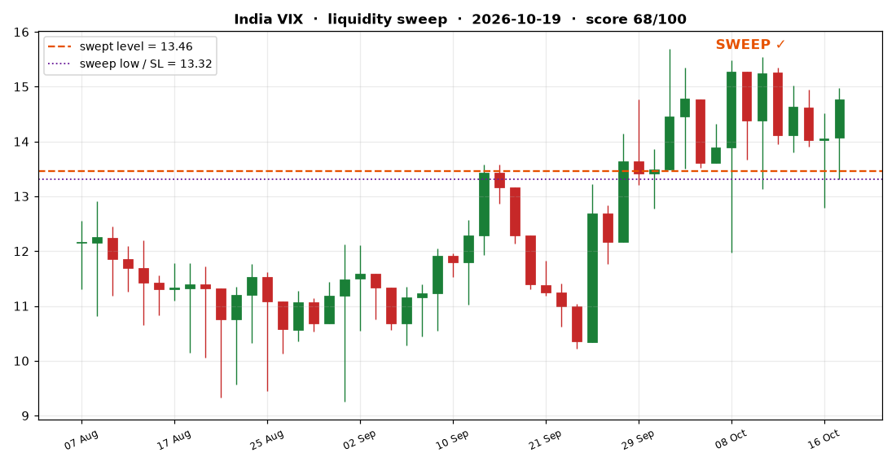

---

## 📅 WEEKLY SWEEP SCANNER — bada timeframe, zyada strong signal

*Last closed week ke hisab se · data till 2026-10-12 · ye signal pura hafta valid rehta hai*

**Ye kya hai (1 line):** Jo kaam daily sweep 1 din mein karta hai, wahi WEEKLY candle par ho to bade khiladi ka POORE HAFTE ka sauda dikhta hai — isliye ye signal zyada bharosemand hai (15-saal test: Nifty +8 hafte 69% win, Bank Nifty 76% win).

### ✅ Pichle closed week mein 16 index par WEEKLY SWEEP COMPLETE:

| # | GRADE | Index | Sweep type | Swept Level | Depth% | Wick% | Pools | 8w RS | Trend | Score |
|---|-------|-------|-----------|-------------|--------|-------|-------|-------|-------|-------|
| 1 | 🟢 A+ | **Nifty MidSmallcap400 Momentum Quality 100** | old swing-low sweep | 49125.70 | 0.99 | 49 | 1 | 75/100 | ❌ | 50 |
| 2 | 🟢 A+ | **Nifty Services Sector** | new-low sweep | 28619.95 | 0.30 | 78 | 1 | 61/100 | ❌ | 57 |
| 3 | 🟢 A+ | **Nifty50 Value 20** | 52w-low sweep | 11001.15 | 0.40 | 71 | 2 | 59/100 | ❌ | 56 |
| 4 | 🟢 A+ | **Nifty IT** | old swing-low sweep | 28442.40 | 2.76 | 82 | 1 | 54/100 | ❌ | 76 |
| 5 | 🟡 B | **Nifty Top 20 Equal Weight** | old swing-low sweep | 8240.40 | 1.18 | 54 | 1 | 40/100 | ❌ | 57 |
| 6 | 🟡 B | **Nifty500 Low Volatility 50** | new-low sweep | 20531.80 | 0.87 | 59 | 1 | 36/100 | ❌ | 57 |
| 7 | 🟡 B | **Nifty Low Volatility 50** | new-low sweep | 22658.85 | 0.62 | 52 | 1 | 35/100 | ❌ | 43 |
| 8 | 🟡 B | **Nifty Shariah 25** | new-low sweep | 7313.20 | 0.56 | 54 | 1 | 32/100 | ❌ | 48 |
| 9 | 🟡 B | **NIFTY Alpha Quality Value Low-Volatility 30** | new-low sweep | 18547.95 | 0.98 | 57 | 1 | 30/100 | ❌ | 57 |
| 10 | 🟡 B | **Nifty Dividend Opportunities 50** | 52w-low sweep | 5360.05 | 0.91 | 63 | 2 | 27/100 | ❌ | 61 |
| 11 | 🟡 B | **Nifty50 Shariah** | 52w-low sweep | 3876.20 | 0.49 | 69 | 2 | 25/100 | ❌ | 56 |
| 12 | 🟡 B | **NIFTY200 Quality 30** | new-low sweep | 18587.35 | 0.54 | 66 | 1 | 23/100 | ❌ | 57 |
| 13 | 🟡 B | **Nifty100 Low Volatility 30** | new-low sweep | 18402.40 | 0.43 | 55 | 1 | 21/100 | ❌ | 45 |
| 14 | 🟡 B | **Nifty Growth Sectors 15** | 52w-low sweep | 10329.35 | 1.09 | 67 | 2 | 12/100 | ❌ | 61 |
| 15 | 🟡 B | **Nifty50 TR 2x Leverage** | 52w-low sweep | 15341.65 | 0.46 | 56 | 2 | 1/100 | ❌ | 48 |
| 16 | 🟡 B | **Nifty50 PR 2x Leverage** | 52w-low sweep | 10062.55 | 0.46 | 56 | 2 | 1/100 | ❌ | 48 |

**GRADE ka matlab (2 saal, 106 indices, 303 weekly sweeps par test):**
- 🟢 **A+** = sweep + index pehle se STRONG (8-hafte RS≥50) → agle 8 hafte market se +2.5% extra, 69% baar beat — YE wale par dhyan do
- 🟡 **B** = sweep hua par index kamzor tha → edge nahi mila, sirf jaankari

**Is hafte ka #1: Nifty MidSmallcap400 Momentum Quality 100** — old swing-low sweep, level 49125.70 raid karke +0.61% upar band hua (1 liquidity pool ek saath saaf kiye).

**Kaise use karna (15-saal validated, swing 4-8 hafte):**
- Weekly sweep = zyada strong — ye index/sector agle 1-2 MAHINE outperform karne ka candidate
- Invalidation: weekly close wapas 48398.29 (sweep low) ke niche = setup fail
- Nifty/BankNifty par 15-saal test: sweep ke baad +8 hafte mein 69-76% baar upar, baseline se ~1-1.4% zyada
- Daily scanner (upar) = roz ka nazara; WEEKLY scanner = bada aur pakka footprint. Dono ek hi index par aayein = SABSE strong combo
- Paisa kitna lagana hai: hamesha MASTER SIGNAL ke deploy % se

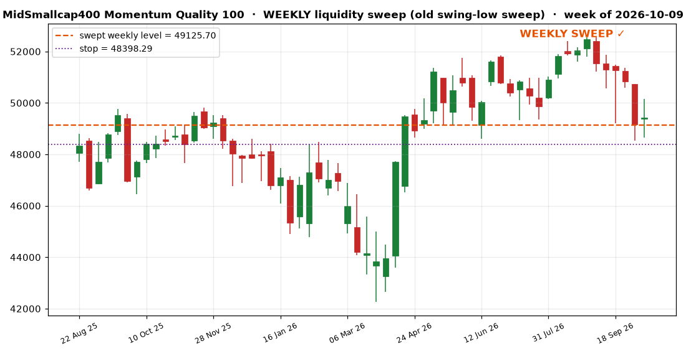

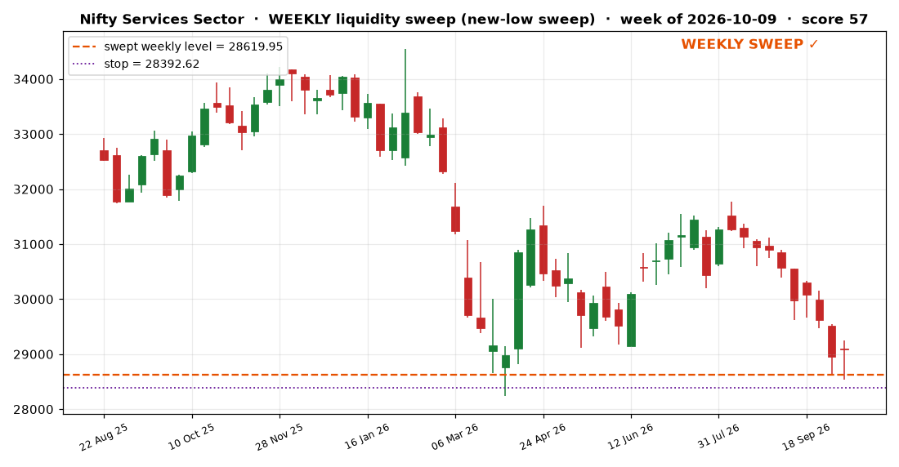

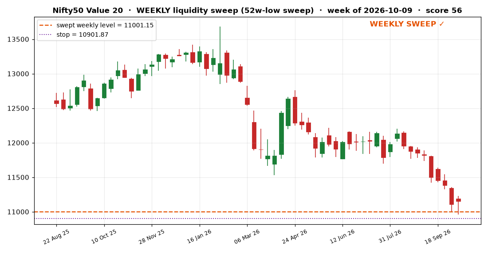

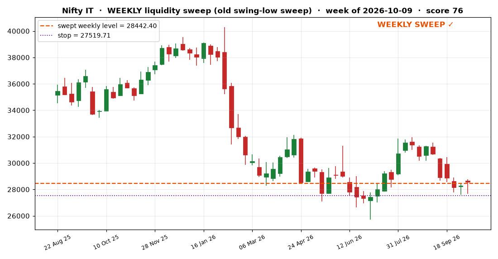

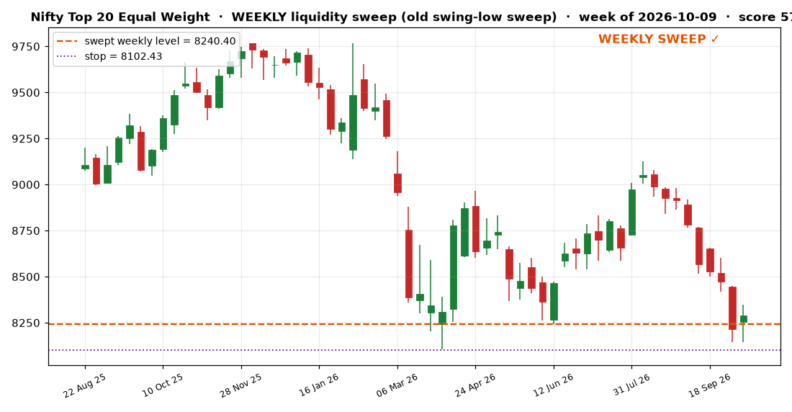

---

## 📋 SWEEP REPORT CARD — pichle setups ab KAISE chal rahe hain?

*Yahan har sweep 1-2 hafte tak dikhta rahega taaki khud dekh sako: sweep ke baad sach mein uptrend aaya ya nahi.*

### 🧲 DAILY sweeps (pichle 10 din ke 47 setups):

| Index | Sweep kab | Kitne din hue | Tab close | Ab close | Badlav | Status |
|-------|-----------|---------------|-----------|----------|--------|--------|
| **Nifty Smallcap 50** | 2026-10-09 | 1 din | 9550.40 | 9698.35 | **+1.5%** | ✅ UPTREND chal raha |
| **Nifty Capital Markets** | 2026-10-09 | 1 din | 5181.15 | 5259.00 | **+1.5%** | ✅ UPTREND chal raha |
| **NIFTY Smallcap 100** | 2026-10-09 | 1 din | 19153.70 | 19425.80 | **+1.4%** | ✅ UPTREND chal raha |
| **Nifty India Defence** | 2026-10-09 | 1 din | 9006.65 | 9122.10 | **+1.3%** | ✅ UPTREND chal raha |
| **Nifty Smallcap250 Momentum Quality 100** | 2026-10-09 | 1 din | 47274.00 | 47813.55 | **+1.1%** | ✅ UPTREND chal raha |
| **Nifty Smallcap 500** | 2026-10-09 | 1 din | 20150.85 | 20358.90 | **+1.0%** | ✅ UPTREND chal raha |
| **Nifty500 Multicap Momentum Quality 50** | 2026-10-09 | 1 din | 39604.55 | 39965.50 | **+0.9%** | ✅ UPTREND chal raha |
| **Nifty Total Market Momentum Quality 50** | 2026-10-09 | 1 din | 42400.70 | 42785.15 | **+0.9%** | ✅ UPTREND chal raha |
| **Nifty500 Momentum 50** | 2026-10-09 | 1 din | 52722.80 | 53127.70 | **+0.8%** | ✅ UPTREND chal raha |
| **Nifty MidSmallcap400 Momentum Quality 100** | 2026-10-09 | 1 din | 49426.05 | 49769.85 | **+0.7%** | ✅ UPTREND chal raha |
| **Nifty Smallcap250 Quality 50** | 2026-10-09 | 1 din | 24023.80 | 24171.20 | **+0.6%** | ✅ UPTREND chal raha |
| **Nifty MidSmallcap400 50:50** | 2026-10-09 | 1 din | 19773.05 | 19892.90 | **+0.6%** | ✅ UPTREND chal raha |
| *...aur 35 setups* | | | | | | *(unme ✅ 10 / ❌ 21)* |

### 📅 WEEKLY sweeps (pichle 3 closed weeks ke 16 setups):

| Index | Sweep week | Kitne hafte hue | Pools | Tab close | Ab close | Badlav | Status |
|-------|------------|-----------------|-------|-----------|----------|--------|--------|
| **Nifty MidSmallcap400 Momentum Quality 100** | 2026-10-09 | 0 hafte | 1 | 49426.05 | 49769.85 | **+0.7%** | ✅ UPTREND chal raha |
| **NIFTY200 Quality 30** | 2026-10-09 | 0 hafte | 1 | 18863.35 | 18836.90 | **-0.1%** | 🟡 WATCH (level ke upar tika hai) |
| **Nifty Growth Sectors 15** | 2026-10-09 | 0 hafte | 2 ⚠️ | 10422.60 | 10382.85 | **-0.4%** | 🟡 WATCH (level ke upar tika hai) |
| **Nifty Shariah 25** | 2026-10-09 | 0 hafte | 1 | 7385.00 | 7356.55 | **-0.4%** | 🟡 WATCH (level ke upar tika hai) |
| **NIFTY Alpha Quality Value Low-Volatility 30** | 2026-10-09 | 0 hafte | 1 | 18675.30 | 18594.95 | **-0.4%** | 🟡 WATCH (level ke upar tika hai) |
| **Nifty500 Low Volatility 50** | 2026-10-09 | 0 hafte | 1 | 20682.95 | 20589.65 | **-0.5%** | 🟡 WATCH (level ke upar tika hai) |
| **Nifty Low Volatility 50** | 2026-10-09 | 0 hafte | 1 | 22846.90 | 22720.75 | **-0.6%** | 🟡 WATCH (level ke upar tika hai) |
| **Nifty100 Low Volatility 30** | 2026-10-09 | 0 hafte | 1 | 18625.40 | 18519.10 | **-0.6%** | 🟡 WATCH (level ke upar tika hai) |
| **Nifty50 Shariah** | 2026-10-09 | 0 hafte | 2 ⚠️ | 3929.95 | 3907.35 | **-0.6%** | 🟡 WATCH (level ke upar tika hai) |
| **Nifty Dividend Opportunities 50** | 2026-10-09 | 0 hafte | 2 ⚠️ | 5419.85 | 5378.50 | **-0.8%** | 🟡 WATCH (level ke upar tika hai) |
| **Nifty Top 20 Equal Weight** | 2026-10-09 | 0 hafte | 1 | 8289.60 | 8224.80 | **-0.8%** | 🟠 KAMZOR (level ke niche, par sweep low nahi toda) |
| **Nifty IT** | 2026-10-09 | 0 hafte | 1 | 28574.90 | 28349.60 | **-0.8%** | 🟠 KAMZOR (level ke niche, par sweep low nahi toda) |
| *...aur 4 setups* | | | | | | | *(unme ✅ 0 / ❌ 0)* |

**Scorecard (weekly):** ✅ 1 working | ❌ 0 failed | baki watch/kamzor — market ke saath milake dekho (agar pura market gira hai to sweep-fail market ki galti hai, system ki nahi).

⚠️ = Pools≥2 (ek saath kai lows toda) — test mein ye setups KAMZOR nikle (43% beat vs 59%), inse bachke raho.

**Status samajhna:** ✅ = sweep sahi nikla, uptrend chal raha | 🟡 = level ke upar hai, thoda aur time do | 🟠 = kamzor pada | ❌ = sweep low toot gaya = setup FAIL, bhool jao

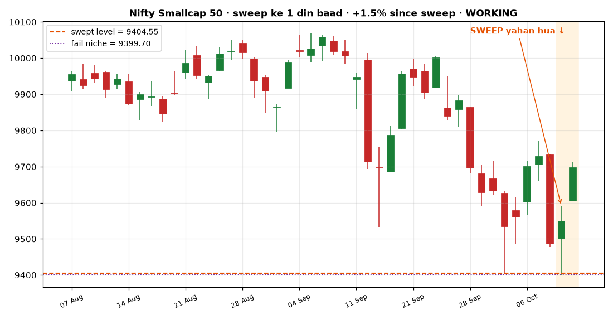

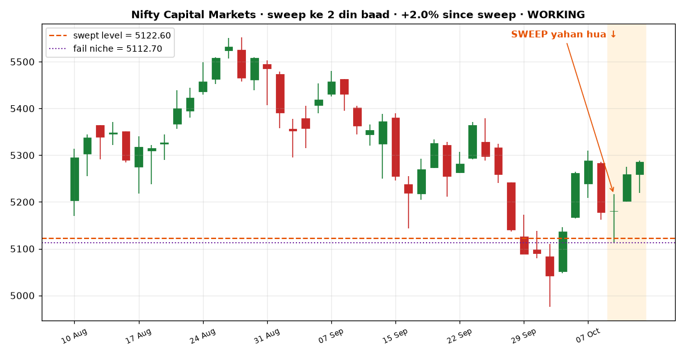

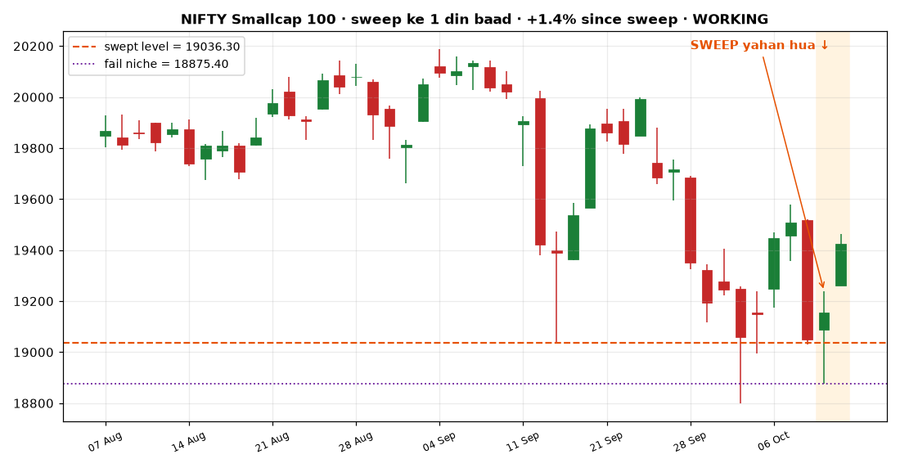

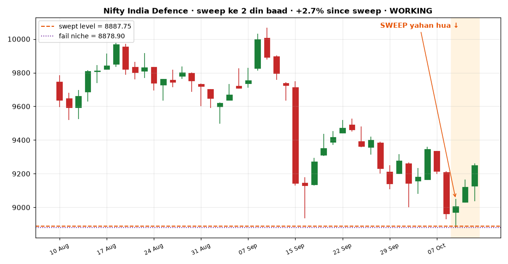

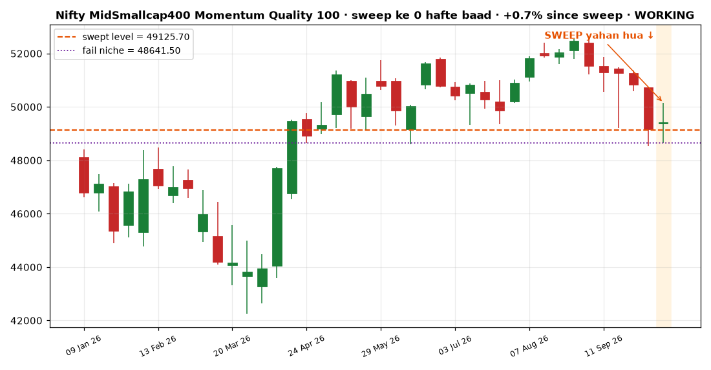

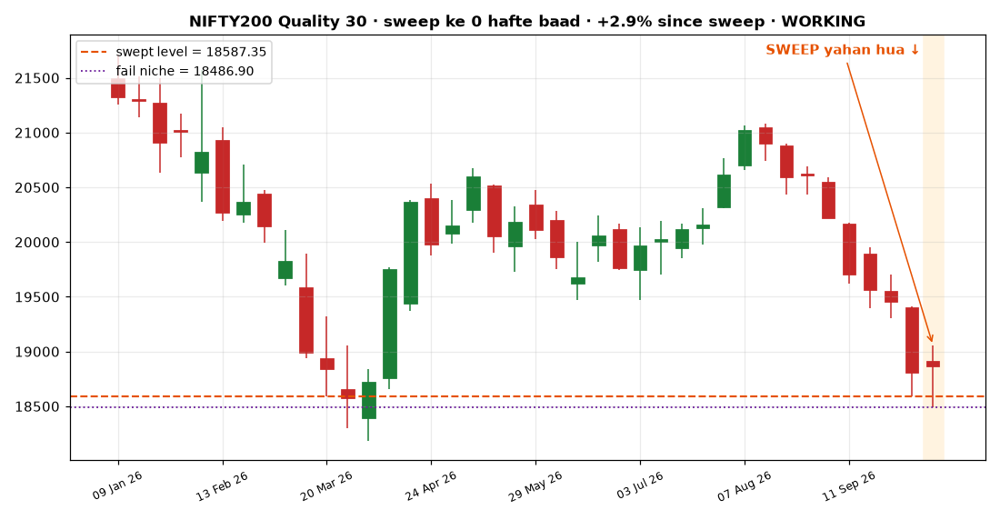

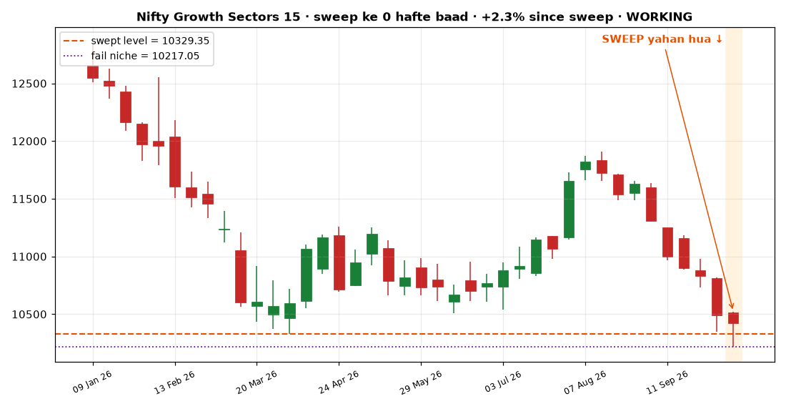

