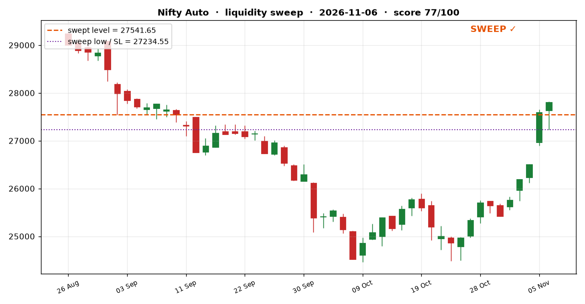
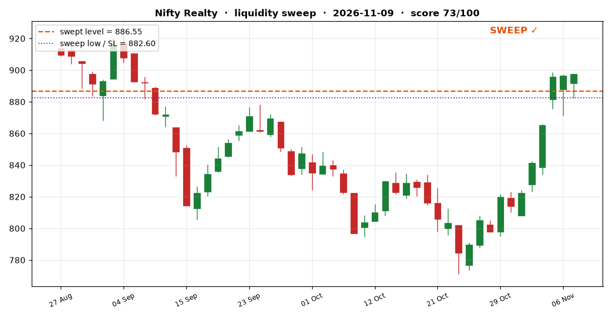
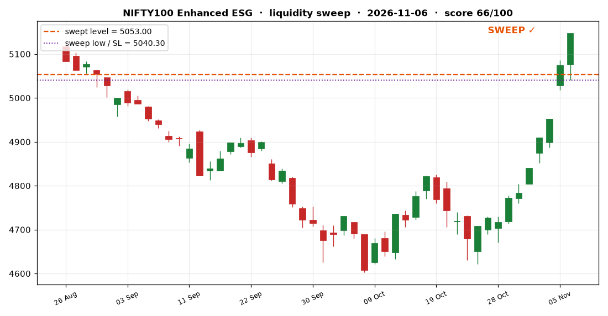
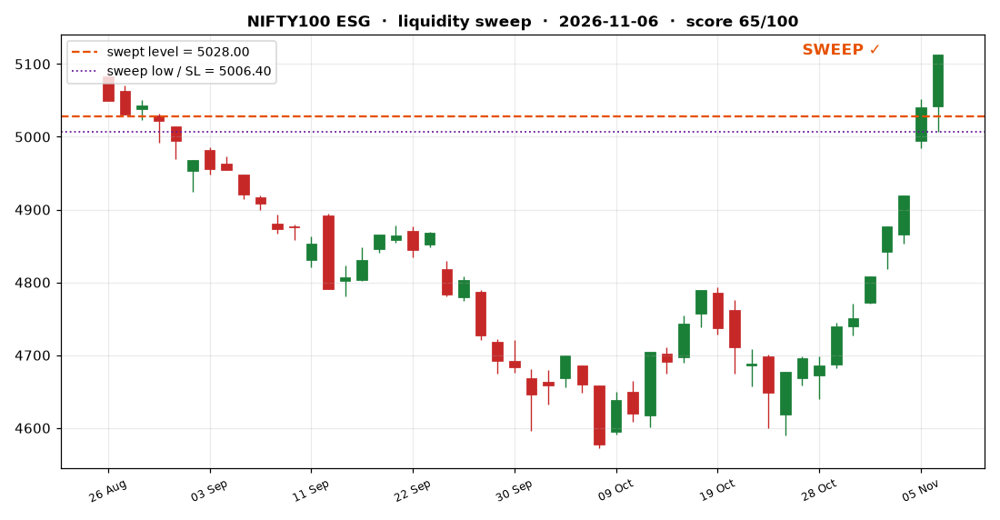
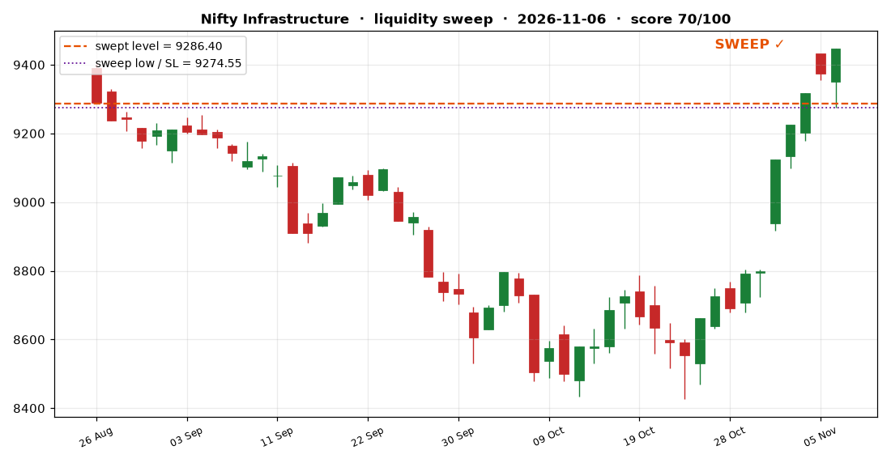
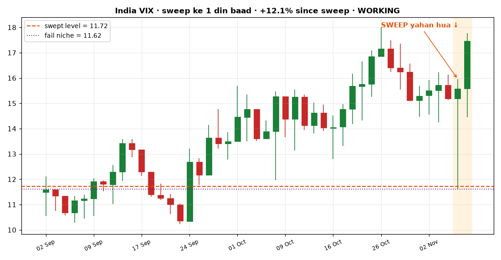
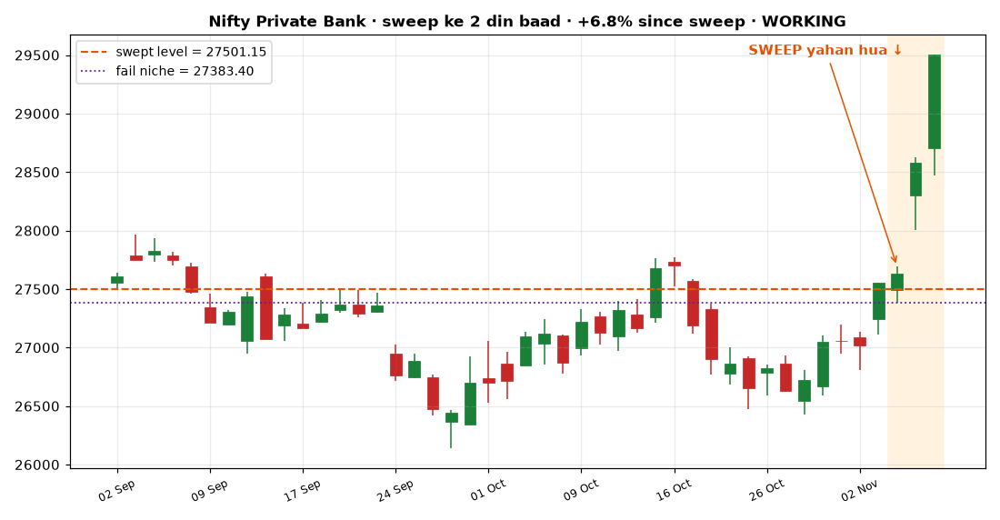
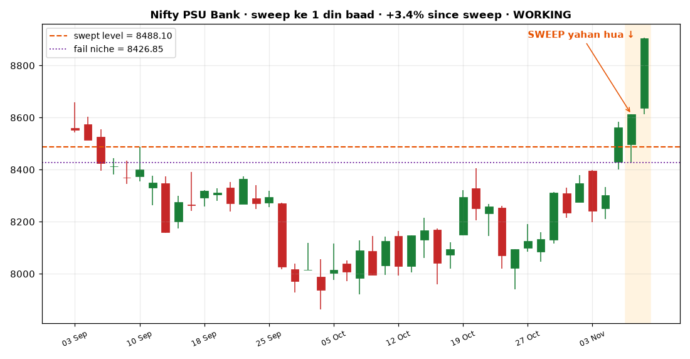
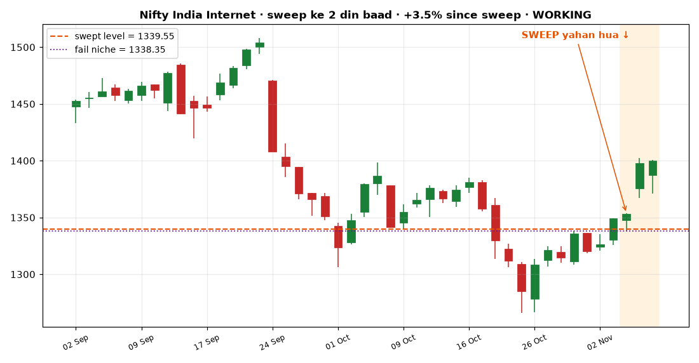

# 🙋 AAJ KA SIGNAL — Simple Bhasha Mein
### Date: 2026-11-06 (shaam ke NSE data se) | Nifty: 25030.35

---

## 🔴 EK LINE MEIN:
> **KHATRA zone — bade khiladi bech rahe hain ya market top ke paas lag raha hai. Naya paisa BILKUL mat lagao. Jo profit bana hai usko bachane ka waqt hai.**

---

## ✅ STEP-BY-STEP — AAJ KARNA KYA HAI:
1. Naya trade: BILKUL NAHI — chahe kitna bhi mann kare
2. Jo trades profit mein hain: thoda profit book kar lo (aadha bech do)
3. Jo loss mein hain: stop-loss aur tight karo (-5%)
4. Cash jama karo — jab STRONG signal aayega tab kaam aayega

---

## 💰 TOTAL KITNA PAISA MARKET MEIN RAKHNA HAI: **70%**
Matlab: agar tumhare paas kul **₹1,00,000** hai investing ke liye, to abhi sirf
**₹70,000** market mein ho aur **₹30,000 cash** mein.
Kyun? Trend upar hai LEKIN bade khiladi zor se BECH rahe hain — ye combo historically kharab hai — isliye thoda paisa nikal ke cash mein rakho.

---

## 📖 MARKET KA HAAL (simple):
| Cheez | Status | Matlab |
|---|---|---|
| Market ka trend | **UPAR ⬆️** | Nifty apni 200-din ki average price se upar hai = healthy |
| Bade khiladi (FII/operators) | **STRONG DOWN** | score -4.43 (+2.5 se upar = zor se kharid rahe; -2.5 se niche = zor se bech rahe) |
| 🟢 Bottom signal | **off** | abhi nahi |
| 🔴 Top warning | **🔴 ACTIVE** | Sab log overconfident = top ke paas ho sakte hain, profit bachao |

**Is signal ki accuracy:** Aise dino ke baad market 10 mein se sirf 5.5 baar upar gaya — yaani coin-flip se bhi bura. Paisa lagane ka koi matlab nahi.

---

## 🔭 AAGE KA NAZARIYA (aaj ke OI signal ke baad kya hota aaya hai — 15 saal ka hisaab)

| Kitne time baad | Kya expect karein | Imandar sach |
|---|---|---|
| **Kal (1 din)** | 🚫 Prediction NAHI | Humne 15 saal test kiya — agle din ka koi bhi signal **coin-flip** hai (53% up, har bucket mein same). Jo bhi "kal ye hoga" bole, usse door raho. |
| **1-4 din** | +0.0% avg, 52% baar upar | Bucket se 1-4 din ka koi bharosemand edge NAHI (aaj ka bucket +0.0%/52% vs baseline +0.2%/56% — farak na ke barabar). Sirf ⚡/🌀 flags fire hone par halka jhukav banta hai. |
| **15 din (3 hafte)** | 🔻 Kamzori ka signal | Aaj ka bucket: -0.0%/52% vs baseline +0.7%/60%. Yahan se signal jaagna shuru hota hai (curve-test: 15d par bearish edge pakki, bullish edge 20d+ se) — par asli kaam 20-60 din mein hi hota hai. 🔻 **Dhyan do: STRONG_DOWN ka 15-din edge ASLI hai** — 15 saal mein dono test-periods kamzor (IS -0.6pp / OOS -0.9pp, 52% vs 60% baseline). Agle 2-3 hafte naya paisa lagane ki jaldi mat karo. |
| **1 mahina (20 din)** | -0.0% avg, **51% baar upar** | baseline se KHARAB (baseline +1.0%/62%). Halka edge shuru hota hai. |
| **2 mahine (40-60 din)** | +0.7% avg, **53% baar upar** | baseline se KHARAB (baseline +3.0%/68%). **YAHI is system ka asli edge hai** — isliye swing hold 1-2 mahine ka hai. |

> 💡 **Matlab:** aaj entry lo to result ka asli test **1-2 mahine baad** hona hai. Beech ke din-hafte ka shor ignore karo — stop-loss (-10%) ke alawa koi reaction mat do.

## 📒 SYSTEM KA APNA REPORT CARD (pichhle 12 mahine ke 208 daily signals — khud ka hisaab)

**20-din accuracy: 66%  |  40-din accuracy: 54%** (✅ = jo promise kiya wahi hua: bullish/neutral bucket → market upar; STRONG_DOWN → market baseline se kamzor)

| Bucket | Signals | 20-din sahi | 40-din sahi | Avg 20d | Avg 40d |
|---|---|---|---|---|---|
| STRONG_UP | 48 | 52% | 31% | +0.3% | -1.0% |
| MILD_UP | 29 | 69% | 31% | +1.1% | -1.9% |
| NEUTRAL | 57 | 53% | 44% | -0.5% | -0.9% |
| MILD_DOWN | 21 | 48% | 52% | -0.5% | -1.5% |
| STRONG_DOWN | 53 | 100% | 100% | -4.3% | -4.9% |

**Aakhri 6 pakke (matured) signals:**

| Signal din | Bucket | 20-din result | 40-din result |
|---|---|---|---|
| 2026-09-08 | NEUTRAL | -5.7% ❌ | +5.9% ✅ |
| 2026-09-07 | NEUTRAL | -4.9% ❌ | +3.2% ✅ |
| 2026-09-04 | NEUTRAL | -4.7% ❌ | +0.3% ✅ |
| 2026-09-03 | NEUTRAL | -5.5% ❌ | -0.3% ❌ |
| 2026-09-02 | NEUTRAL | -6.2% ❌ | -2.0% ❌ |
| 2026-09-01 | NEUTRAL | -6.0% ❌ | -4.2% ❌ |

**Abhi chal rahe (open) signals:**

| Signal din | Bucket | Beete din | Ab tak |
|---|---|---|---|
| 2026-11-05 | STRONG_DOWN | 1 din | +2.0% ⏳ |
| 2026-11-04 | MILD_DOWN | 2 din | +4.5% ⏳ |
| 2026-11-03 | MILD_UP | 3 din | +5.1% ⏳ |
| 2026-11-02 | STRONG_UP | 4 din | +6.8% ⏳ |
| 2026-10-30 | STRONG_UP | 5 din | +8.6% ⏳ |

> 🪞 **Ye section khud-ba-khud roz update hota hai — system apne purane signals se bhaag nahi sakta.** Accuracy girne lage to turant dikh jayega.

## 📋 SWING TRADE BAND HUA (virtual)

Pichla trade: entry 22,603 (2026-10-07) → exit 24,537 (2026-11-05)
= **+8.55%** | Wajah: EXIT SIGNAL (score -2.7 <= -2.5)

> Abhi koi khula trade nahi. Agla STRONG_BUY (B3) aane par naya trade khulega — email khud bata dega.

## 🏦 BANK NIFTY — WAHI SIGNAL, DUSRA INDEX (15-saal verified)

**Aaj:** Bank Nifty **57,774** (+3.33% din ka)

| Horizon | Aaj ke bucket (STRONG DOWN) ke baad BNF | Baseline |
|---|---|---|
| 15 din | -0.0% avg, 51% baar upar | +0.9% / 58% |
| 1 mahina | +0.0% avg, 51% baar upar | +1.2% / 59% |
| 2 mahine | **+0.4% avg, 53% baar upar** | +2.4% / 64% |

> 🔻 **BNF par bhi wahi kahani:** STRONG_DOWN mein Bank Nifty 2 mahine tak lagbhag flat/negative raha hai (baseline +2.4% chhodo) — BANKBEES entry se bhi door raho.
> 💡 Participant OI (FII/Pro) ka signal poore market ka hai — Bank Nifty par bhi 15 saal test kiya
> (correlation +0.157 @40d). STRONG_UP mein BNF ka 2-mahina record Nifty se bhi tez hai
> (out-of-sample +3.8%/79%). Trade karna ho to **BANKBEES** ETF.

## 🧭 SECTOR ROTATION — SABSE MAJBOOT SECTOR (15-saal tested)

**⏸️ STANDBY** — OI signal abhi bullish nahi (score -4.4 < +1.0). 15-saal test ne saaf dikhaya: sector tilt **sirf bullish signal ke saath** kaam karta hai (bina signal: out-of-sample NEGATIVE tha). Isliye abhi sirf ranking dekho, lagao mat.

| Rank | Sector | 6-mahina momentum |
|---|---|---|
| 1 | 🟢 **IT** | +19.5% |
| 2 | 🟢 **Realty** | +17.7% |
| 3 | · **Bank** | +9.2% |
| 4 | · **Auto** | +8.9% |
| 5 | · **Telecom** | +8.7% |
| 6 | · **Pharma** | +6.4% |
| 7 | · **Infra** | +5.2% |
| 8 | · **Energy** | +4.5% |
| 9 | · **Consumer** | +3.9% |
| 10 | · **CapGoods** | +3.5% |
| 11 | · **Cement** | -2.3% |
| 12 | · **Finance** | -4.5% |
| 13 | · **Metal** | -8.2% |
| 14 | 🔴 **FMCG** | -8.9% |
| 15 | 🔴 **Power** | -10.8% |

**Kya karna:** Intezaar. Jab upar wala signal MILD_UP/STRONG_UP ho, tab ye section ACTIVE ho jayega.

**Top-2 sectors ke stocks (RS order, sirf jankari ke liye):**
- **IT:** COFORGE (+58%), TECHM (+34%), HCLTECH (+26%), PERSISTENT (+26%), MPHASIS (+20%), LTTS (+19%)
- **Realty:** DLF (+33%), PHOENIXLTD (+23%), PRESTIGE (+19%), OBEROIRLTY (+7%), GODREJPROP (+7%)

> 🔴 = sabse kamzor 2 sectors — yahan naya paisa mat lagao.
> 📏 Rule yaad rakho: KAB/KITNA upar ka MASTER SIGNAL batata hai — ye section sirf **KAHAN** (kaunsa sector) batata hai. Stop-loss -10% yahan bhi.

## 💎 GEM SCANNER — aaj koi setup nahi (2026-11-06)

**Pattern (15y decoded):** 52w-high se **40%+ gira** + **EMA50 wapas reclaim** (stabilize ho gaya) + **volume 1.5x surge** (koi bada jama kar raha). Test: aise setup ka **32.4%** chance hota hai +25% move ka (normal stock ka sirf 10.7%).

Aaj koi stock teeno sharten poori nahi karta — **ye normal hai** (ye setup mahine mein ~1 baar aata hai;
isi selectivity se edge hai). **Banne ke kareeb (volume ka intezaar):** VEDL.

**📒 Pichle gems ka hisaab:** 2026-10-08 TRENT: 🔄 OPEN +6% (20d) · 2026-10-09 TRENT: 🔄 OPEN +6% (19d) · 2026-10-14 TATAELXSI: 🔄 OPEN +14% (16d)

> 🔎 *Imandari note: backtest aaj ke zinda stocks par hai (survivorship) — isliye real expectancy thodi kam maan ke chalo; position sizing (5-10% max) hi asli suraksha hai. Midcaps par ye pattern TEST KIYA aur FAIL hua (+1.2% vs +6.7-11.5%) — gems sirf LARGE-CAP mein khoje jayenge, kyunki quality ka floor wahi hota hai.*

## 🏆 STOCK SWEEP — NIFTY 50 KE SABSE STRONG STOCKS (2026-11-05)

**Rule (15-saal tested):** A+ = price EMA50 ke upar **+** RS top-10% (126-din return, 50 stocks mein).
In stocks ne equal-weight basket ko average **+1.0pp (40 din) / +1.7pp (60 din)** se beat kiya
(out-of-sample bhi positive: +0.5/+1.1pp). Edge chhota par 15 saal consistent — horizon **1-3 mahine**.

| Stock | Grade | RS rank /100 | 1-mahina return | Price |
|---|---|---|---|---|
| **DIVISLAB** | A+ ⭐ | 100 | +6.2% | 10,140 |
| **TECHM** | A+ ⭐ | 97 | +21.1% | 1,823 |
| **HCLTECH** | A+ ⭐ | 95 | +18.8% | 1,430 |
| **KOTAKBANK** | A+ ⭐ | 93 | +8.1% | 467 |
| **ICICIBANK** | A+ ⭐ | 91 | +11.7% | 1,500 |
| TITAN | B (watch) | 89 | +6.3% | 4,835 |
| BAJFINANCE | B (watch) | 87 | +11.1% | 1,070 |
| BHARTIARTL | B (watch) | 85 | +13.6% | 2,057 |

> 💡 **Kaise use karein:** ye "kya kharidna" ka shortlist hai — lekin **kab/kitna** upar wala MASTER
> SIGNAL hi batayega. Entry signal weak ho to shortlist sirf watchlist hai. Stop-loss -10% yahan bhi pakka.

---

## 🧒 PAKKE NIYAM (har naye bande ke liye, HAMESHA):
1. **Stop-loss -10%:** jo bhi kharido, kharid-price se 10% girte hi bech do. Bina sawal. (15-saal test: -8% se -10% behtar nikla — bazaar ke chhote jhatke trade ko bekar mein nahi todte, aur bade nuksan se phir bhi bachata hai.)
2. **Kabhi ek saath pura paisa nahi** — hamesha 2-3 kisht mein.
3. **Udhaar/EMI/zaroorat ka paisa KABHI nahi** — sirf wo paisa jo 6 mahine na chahiye.
4. Ye system 10 mein se 7-8 baar sahi hai — **2-3 baar galat bhi hoga.** Isliye upar ke niyam hi tumhara asli bachav hain.
5. Kya kharidna hai confusion ho to: **NIFTYBEES** (Nifty 50 ETF) — isi index par ye pura system bana hai.

*Ye financial advice nahi hai — 15 saal ke data par bana educational system hai. | Generated: 2026-11-06T20:26:38+00:00 UTC*

---

## 🧲 INDEX SWEEP SCANNER — konsa index STRONG hai?

*Session: 2026-11-06 · scan: saare NSE indices (bond/G-sec chhodke)*

**Ye kya hai (1 line):** Jab koi index apne purane LOW ke niche wick maar ke wapas UPAR band ho (= stop-loss hunt complete), to wo index aur uske stocks aage strong rehne ke candidate hain.

### ✅ Aaj 44 index mein SWEEP COMPLETE hua:

| # | GRADE | Index | 20d RS rank | Swept Level | Depth% | Wick% | Close vs Level | RSI | Trend(>E50) | Score |
|---|-------|-------|-------------|-------------|--------|-------|----------------|-----|-------------|-------|
| 1 | 🟢 A+ | **Nifty Auto** | 95/100 | 27541.65 | 1.12 | 68 | +0.98% | 70 | ✅ | 77 |
| 2 | 🟢 A+ | **Nifty Realty** | 88/100 | 886.55 | 1.72 | 63 | +1.14% | 68 | ✅ | 68 |
| 3 | 🟢 A+ | **NIFTY100 Enhanced ESG** | 86/100 | 5053.00 | 0.25 | 33 | +1.87% | 76 | ✅ | 66 |
| 4 | 🟢 A+ | **NIFTY100 ESG** | 85/100 | 5028.00 | 0.43 | 33 | +1.69% | 76 | ✅ | 65 |
| 5 | 🟢 A+ | **Nifty Infrastructure** | 80/100 | 9286.40 | 0.13 | 44 | +1.73% | 75 | ✅ | 70 |
| 6 | 🟢 A+ | **Nifty Cement** | 76/100 | 14339.90 | 0.49 | 36 | +1.63% | 68 | ✅ | 71 |
| 7 | 🟢 A+ | **Nifty Dividend Opportunities 50** | 74/100 | 5784.00 | 0.15 | 44 | +1.33% | 71 | ✅ | 70 |
| 8 | 🟢 A+ | **NIFTY100 Quality 30** | 73/100 | 5660.70 | 0.62 | 60 | +0.63% | 70 | ✅ | 71 |
| 9 | 🟢 A+ | **Nifty India New Age Consumption** | 71/100 | 11846.90 | 0.53 | 42 | +1.44% | 70 | ✅ | 67 |
| 10 | 🟢 A+ | **Nifty Commodities** | 68/100 | 9601.80 | 1.50 | 33 | +1.00% | 69 | ✅ | 60 |
| 11 | 🟢 A+ | **Nifty Oil & Gas** | 65/100 | 11071.45 | 0.11 | 33 | +1.96% | 69 | ✅ | 69 |
| 12 | 🟢 A+ | **Nifty Core Housing** | 63/100 | 15170.25 | 1.51 | 38 | +0.54% | 69 | ✅ | 62 |
| 13 | 🟢 A+ | **Nifty PSU Bank** | 53/100 | 8488.10 | 0.72 | 38 | +1.47% | 65 | ✅ | 66 |
| 14 | 🟢 A+ | **NIFTY200 Quality 30** | 50/100 | 19700.50 | 0.45 | 68 | +1.00% | 65 | ✅ | 76 |
| 15 | 🟡 B | **Nifty200 Value 30** | 49/100 | 14460.00 | 1.11 | 43 | +1.27% | 68 | ✅ | 65 |
| 16 | 🟡 B | **Nifty India Manufacturing** | 46/100 | 15582.10 | 0.34 | 51 | +1.76% | 65 | ✅ | 74 |
| 17 | 🟡 B | **Nifty Metal** | 45/100 | 12275.90 | 0.13 | 52 | +3.28% | 61 | ✅ | 76 |
| 18 | 🟡 B | **Nifty500 Shariah** | 44/100 | 6854.35 | 0.59 | 79 | +0.60% | 66 | ✅ | 79 |
| 19 | 🟡 B | **Nifty500 Multicap 50:25:25** | 43/100 | 16209.40 | 0.21 | 41 | +1.49% | 68 | ✅ | 70 |
| 20 | 🟡 B | **NIFTY100 Alpha 30** | 41/100 | 17361.35 | 0.68 | 47 | +1.62% | 63 | ✅ | 70 |
| 21 | 🟡 B | **Nifty High Beta 50** | 41/100 | 4246.50 | 0.58 | 48 | +1.48% | 63 | ✅ | 71 |
| 22 | 🟡 B | **Nifty500 Quality 50** | 40/100 | 18832.45 | 0.27 | 89 | +0.94% | 61 | ✅ | 81 |
| 23 | 🟡 B | **Nifty Next 50** | 39/100 | 71063.20 | 0.59 | 63 | +0.84% | 63 | ✅ | 75 |
| 24 | 🟡 B | **Nifty India Infrastructure & Logistics** | 38/100 | 11590.85 | 0.42 | 50 | +1.39% | 63 | ✅ | 71 |
| 25 | 🟡 B | **Nifty Midcap 50** | 38/100 | 17373.70 | 1.12 | 51 | +0.67% | 62 | ✅ | 71 |
| 26 | 🟡 B | **Nifty PSE** | 36/100 | 9413.80 | 1.26 | 50 | +1.25% | 63 | ✅ | 68 |
| 27 | 🟡 B | **NIFTY500 Value 50** | 35/100 | 15410.20 | 1.71 | 60 | +0.33% | 63 | ✅ | 68 |
| 28 | 🟡 B | **Nifty200 Alpha 30** | 35/100 | 25611.00 | 0.17 | 56 | +2.12% | 62 | ✅ | 76 |
| 29 | 🟡 B | **Nifty500 LargeMidSmall Equal-Cap Weighted** | 34/100 | 18006.05 | 0.40 | 49 | +1.07% | 64 | ✅ | 73 |
| 30 | 🟡 B | **NIFTY Midcap 100** | 32/100 | 60189.05 | 0.86 | 66 | +0.69% | 61 | ✅ | 79 |
| 31 | 🟡 B | **Nifty Midcap Select** | 31/100 | 13839.65 | 0.58 | 62 | +1.22% | 60 | ✅ | 79 |
| 32 | 🟡 B | **Nifty Midcap 150** | 30/100 | 22101.20 | 0.70 | 68 | +0.77% | 61 | ✅ | 80 |
| 33 | 🟡 B | **Nifty MidSmallcap400 Momentum Quality 100** | 27/100 | 50241.70 | 0.51 | 75 | +0.94% | 59 | ✅ | 80 |
| 34 | 🟡 B | **Nifty200 Momentum 30** | 26/100 | 29314.65 | 0.63 | 49 | +2.09% | 59 | ✅ | 72 |
| 35 | 🟡 B | **Nifty MidSmall Financial Services** | 25/100 | 21036.25 | 0.57 | 45 | +1.75% | 58 | ✅ | 76 |
| 36 | 🟡 B | **Nifty MidSmallcap 400** | 21/100 | 20446.70 | 1.09 | 78 | +0.21% | 57 | ✅ | 79 |
| 37 | 🟡 B | **Nifty Smallcap250 Quality 50** | 20/100 | 24525.80 | 0.50 | 77 | +0.25% | 57 | ✅ | 82 |
| 38 | 🟡 B | **Nifty Smallcap 50** | 17/100 | 9532.70 | 0.14 | 80 | +1.25% | 54 | ✅ | 85 |
| 39 | ⚪ C | **Nifty India Railways PSU** | 29/100 | 2540.05 | 0.30 | 54 | +1.76% | 55 | ❌ | 67 |
| 40 | ⚪ C | **Nifty500 Multicap Momentum Quality 50** | 14/100 | 39149.20 | 0.36 | 63 | +1.72% | 54 | ❌ | 70 |
| 41 | ⚪ C | **Nifty Total Market Momentum Quality 50** | 13/100 | 42356.30 | 1.27 | 66 | +0.60% | 54 | ❌ | 66 |
| 42 | ⚪ C | **Nifty India Defence** | 8/100 | 8725.45 | 0.11 | 88 | +2.34% | 47 | ❌ | 70 |
| 43 | ⚪ C | **NIFTY Smallcap 100** | 7/100 | 18797.65 | 0.21 | 91 | +0.94% | 51 | ❌ | 74 |
| 44 | ⚪ C | **Nifty Alpha 50** | 2/100 | 51967.85 | 0.29 | 71 | +1.46% | 45 | ❌ | 69 |

**GRADE ka matlab (1 saal, 131 indices, 1,486 sweeps par test kiya):**
- 🟢 **A+** = sweep + index pehle se STRONG (RS≥50) + trend upar → aage 10-20 din baaki market se behtar chalne ke best chances (+0.9% extra, 54-55% beat)
- 🟡 **B** = sweep + (strong RS *ya* uptrend, dono nahi) → theek-thaak, half conviction
- ⚪ **C** = weak index ka counter-trend sweep → KOI edge nahi mila, sirf jaankari

**Aaj ka #1: Nifty Auto** (🟢 A+) — level 27541.65 sweep karke +0.98% upar band hua.

**Kaise use karna (swing ke liye):**
- Ye WATCHLIST hai, buy-order nahi — A+ wale index (aur uske bade stocks) nazar mein rakho
- Agle din index **27541.65 ke UPAR TIKA RAHE** to setup valid
- Setup FAIL = close wapas sweep low (27234.55) ke niche → bhool jao
- Paisa lagana hamesha MASTER SIGNAL (upar wala) ke hisab se — ye scanner sirf batata hai KONSA index/sector strong hai

---

## 📅 WEEKLY SWEEP SCANNER — bada timeframe, zyada strong signal

*Last closed week ke hisab se · data till 2026-11-06 · ye signal pura hafta valid rehta hai*

**Ye kya hai (1 line):** Jo kaam daily sweep 1 din mein karta hai, wahi WEEKLY candle par ho to bade khiladi ka POORE HAFTE ka sauda dikhta hai — isliye ye signal zyada bharosemand hai (15-saal test: Nifty +8 hafte 69% win, Bank Nifty 76% win).

### Pichle closed week mein koi WEEKLY sweep setup NAHI bana.
Ye normal hai — weekly sweep rare hota hai. Jis hafte aayega, yahan chart ke saath dikhega.

---

## 📋 SWEEP REPORT CARD — pichle setups ab KAISE chal rahe hain?

*Yahan har sweep 1-2 hafte tak dikhta rahega taaki khud dekh sako: sweep ke baad sach mein uptrend aaya ya nahi.*

### 🧲 DAILY sweeps (pichle 10 din ke 52 setups):

| Index | Sweep kab | Kitne din hue | Tab close | Ab close | Badlav | Status |
|-------|-----------|---------------|-----------|----------|--------|--------|
| **India VIX** | 2026-11-05 | 1 din | 15.58 | 17.47 | **+12.1%** | ✅ UPTREND chal raha |
| **Nifty Private Bank** | 2026-11-04 | 2 din | 27632.30 | 29503.40 | **+6.8%** | ✅ UPTREND chal raha |
| **Nifty PSU Bank** | 2026-11-04 | 2 din | 8302.30 | 8612.90 | **+3.7%** | ✅ UPTREND chal raha |
| **Nifty India Internet** | 2026-11-04 | 2 din | 1353.30 | 1400.00 | **+3.5%** | ✅ UPTREND chal raha |
| **Nifty500 Multicap Momentum Quality 50** | 2026-11-04 | 2 din | 39905.20 | 39822.20 | **-0.2%** | 🟡 WATCH (level ke upar tika hai) |
| **Nifty Total Market Momentum Quality 50** | 2026-11-04 | 2 din | 42956.00 | 42609.00 | **-0.8%** | 🟡 WATCH (level ke upar tika hai) |
| **Nifty100 Low Volatility 30** | 2026-11-03 | 3 din | 19535.70 | 20206.00 | **+3.4%** | ✅ UPTREND chal raha |
| **Nifty500 Low Volatility 50** | 2026-11-03 | 3 din | 21742.15 | 22266.30 | **+2.4%** | ✅ UPTREND chal raha |
| **Nifty Healthcare Index** | 2026-11-03 | 3 din | 16580.40 | 16931.20 | **+2.1%** | ✅ UPTREND chal raha |
| **NIFTY Quality Low-Volatility 30** | 2026-11-02 | 4 din | 15932.80 | 16738.75 | **+5.1%** | ✅ UPTREND chal raha |
| **Nifty IPO** | 2026-11-02 | 4 din | 2284.40 | 2375.20 | **+4.0%** | ✅ UPTREND chal raha |
| **Nifty500 Momentum 50** | 2026-11-02 | 4 din | 52122.60 | 53072.85 | **+1.8%** | ✅ UPTREND chal raha |
| *...aur 40 setups* | | | | | | *(unme ✅ 39 / ❌ 0)* |

### 📅 WEEKLY sweeps (pichle 3 closed weeks ke 1 setups):

| Index | Sweep week | Kitne hafte hue | Pools | Tab close | Ab close | Badlav | Status |
|-------|------------|-----------------|-------|-----------|----------|--------|--------|
| **Nifty Bank** | 2026-10-30 | 1 hafte | 1 | 54686.95 | 59086.00 | **+8.0%** | ✅ UPTREND chal raha |

**Scorecard (weekly):** ✅ 1 working | ❌ 0 failed | baki watch/kamzor — market ke saath milake dekho (agar pura market gira hai to sweep-fail market ki galti hai, system ki nahi).

⚠️ = Pools≥2 (ek saath kai lows toda) — test mein ye setups KAMZOR nikle (43% beat vs 59%), inse bachke raho.

**Status samajhna:** ✅ = sweep sahi nikla, uptrend chal raha | 🟡 = level ke upar hai, thoda aur time do | 🟠 = kamzor pada | ❌ = sweep low toot gaya = setup FAIL, bhool jao

