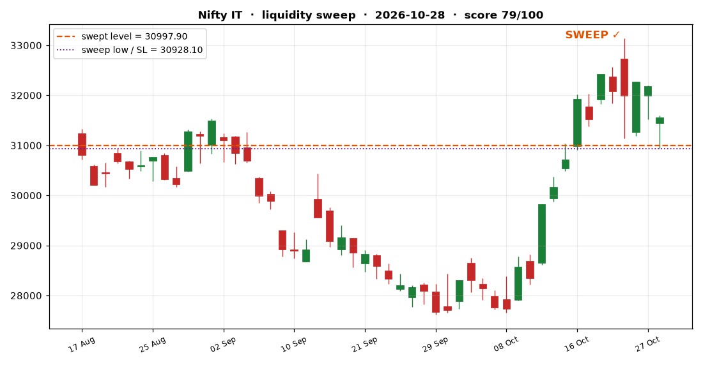
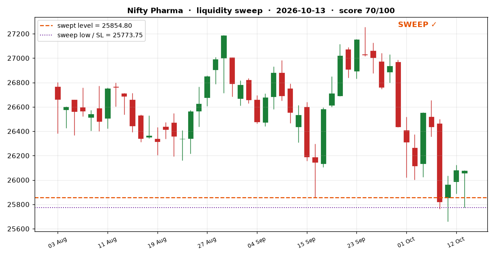
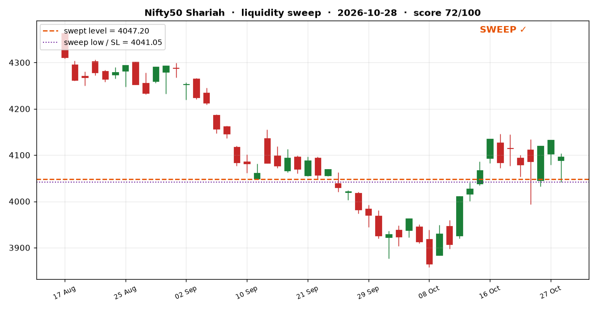
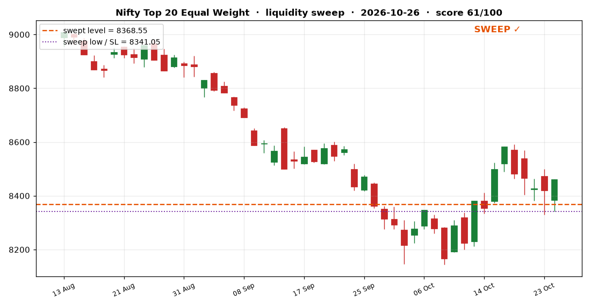
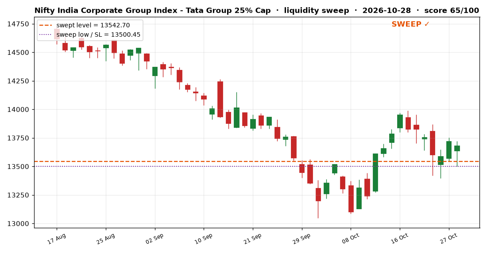
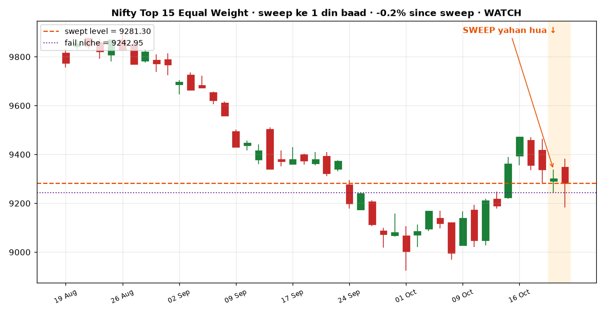
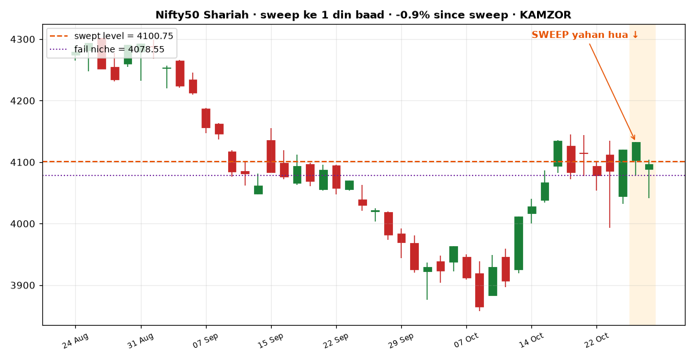
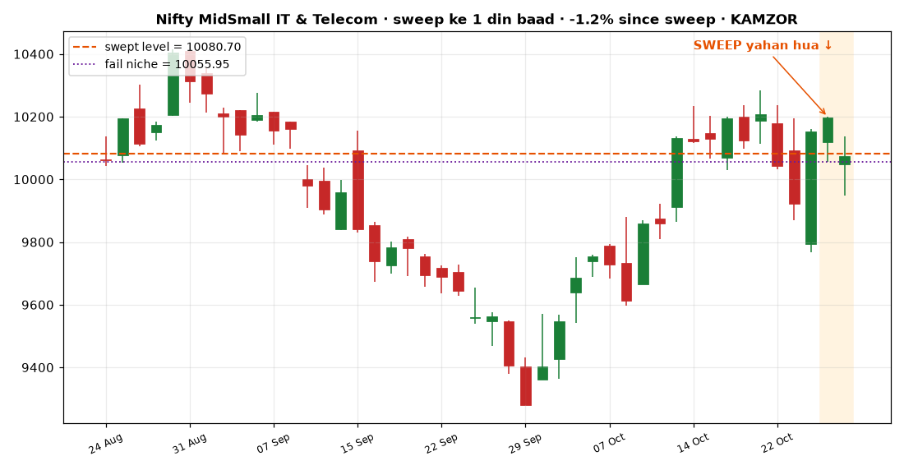

# 🙋 AAJ KA SIGNAL — Simple Bhasha Mein
### Date: 2026-10-28 (shaam ke NSE data se) | Nifty: 22698.85

---

## 🟢🟢 EK LINE MEIN:
> **Market gir ke sasta hua hai aur bade khiladi (operators/FII) chupke se KHARID rahe hain — naya swing trade shuru karne ka SABSE ACHHA mauka. Aise mauke saal mein sirf 2-3 baar aate hain.**

---

## ✅ STEP-BY-STEP — AAJ KARNA KYA HAI:
1. Jitna paisa is trade ke liye socha hai, usse 3 hisson mein baanto
2. Pehla hissa (1/3) AAJ/KAL kharido (Nifty 50 index fund / NIFTYBEES)
3. Dusra hissa tab kharido agar market 2% aur gire
4. Teesra hissa tab agar 4% aur gire — girna accha hai, aur sasta milega!
5. Har kharid par likh lo: 'agar meri kharid se 8% niche gaya to bech dunga' — ye wada khud se karo

---

## 💰 TOTAL KITNA PAISA MARKET MEIN RAKHNA HAI: **30%**
Matlab: agar tumhare paas kul **₹1,00,000** hai investing ke liye, to abhi sirf
**₹30,000** market mein ho aur **₹70,000 cash** mein.
Kyun? Market ka trend NEECHE hai (Nifty apni 200-din ki average se niche) — isliye zyada paisa cash mein rakho, sirf thoda market mein.

---

## 📖 MARKET KA HAAL (simple):
| Cheez | Status | Matlab |
|---|---|---|
| Market ka trend | **NEECHE ⬇️** | Nifty apni 200-din ki average price se niche hai = kamzor |
| Bade khiladi (FII/operators) | **NEUTRAL** | score +0.58 (+2.5 se upar = zor se kharid rahe; -2.5 se niche = zor se bech rahe) |
| 🟢 Bottom signal | **🟢 ACTIVE** | Market sasta + bade log kharid rahe = bottom banne wala hai (10 mein 8 baar sahi) |
| 🔴 Top warning | **off** | abhi nahi |

**Is signal ki accuracy:** Pichle 15 saal mein ye signal 40 baar aaya — 10 mein se 8 baar market 20 din ke andar bottom bana ke upar gaya.

---

## 🔭 AAGE KA NAZARIYA (aaj ke OI signal ke baad kya hota aaya hai — 15 saal ka hisaab)

| Kitne time baad | Kya expect karein | Imandar sach |
|---|---|---|
| **Kal (1 din)** | 🚫 Prediction NAHI | Humne 15 saal test kiya — agle din ka koi bhi signal **coin-flip** hai (53% up, har bucket mein same). Jo bhi "kal ye hoga" bole, usse door raho. |
| **1-4 din** | +0.3% avg, 58% baar upar | Bucket se 1-4 din ka koi bharosemand edge NAHI (aaj ka bucket +0.3%/58% vs baseline +0.2%/56% — farak na ke barabar). Sirf ⚡/🌀 flags fire hone par halka jhukav banta hai. |
| **15 din (3 hafte)** | +1.2% avg, 63% baar upar | Aaj ka bucket: +1.2%/63% vs baseline +0.7%/60%. Yahan se signal jaagna shuru hota hai (curve-test: 15d par bearish edge pakki, bullish edge 20d+ se) — par asli kaam 20-60 din mein hi hota hai. |
| **1 mahina (20 din)** | +1.4% avg, **66% baar upar** | baseline se BEHTAR (baseline +1.0%/62%). Halka edge shuru hota hai. |
| **2 mahine (40-60 din)** | +3.6% avg, **69% baar upar** | baseline se BEHTAR (baseline +3.0%/68%). **YAHI is system ka asli edge hai** — isliye swing hold 1-2 mahine ka hai. |

> 💡 **Matlab:** aaj entry lo to result ka asli test **1-2 mahine baad** hona hai. Beech ke din-hafte ka shor ignore karo — stop-loss (-10%) ke alawa koi reaction mat do.

## 📒 SYSTEM KA APNA REPORT CARD (pichhle 12 mahine ke 207 daily signals — khud ka hisaab)

**20-din accuracy: 70%  |  40-din accuracy: 56%** (✅ = jo promise kiya wahi hua: bullish/neutral bucket → market upar; STRONG_DOWN → market baseline se kamzor)

| Bucket | Signals | 20-din sahi | 40-din sahi | Avg 20d | Avg 40d |
|---|---|---|---|---|---|
| STRONG_UP | 48 | 52% | 31% | +0.3% | -1.0% |
| MILD_UP | 33 | 73% | 36% | +1.1% | -1.5% |
| NEUTRAL | 51 | 61% | 45% | +0.3% | -1.0% |
| MILD_DOWN | 22 | 50% | 55% | -0.4% | -1.4% |
| STRONG_DOWN | 53 | 100% | 100% | -4.3% | -4.9% |

**Aakhri 6 pakke (matured) signals:**

| Signal din | Bucket | 20-din result | 40-din result |
|---|---|---|---|
| 2026-08-28 | MILD_DOWN | -5.8% ❌ | -6.1% ❌ |
| 2026-08-27 | MILD_DOWN | -3.9% ❌ | -5.6% ❌ |
| 2026-08-26 | MILD_DOWN | -4.7% ❌ | -6.0% ❌ |
| 2026-08-25 | NEUTRAL | -3.6% ❌ | -7.1% ❌ |
| 2026-08-24 | NEUTRAL | -3.7% ❌ | -6.3% ❌ |
| 2026-08-21 | MILD_UP | -3.5% ❌ | -5.9% ❌ |

**Abhi chal rahe (open) signals:**

| Signal din | Bucket | Beete din | Ab tak |
|---|---|---|---|
| 2026-10-27 | NEUTRAL | 1 din | -0.2% ⏳ |
| 2026-10-26 | STRONG_UP | 2 din | -0.2% ⏳ |
| 2026-10-23 | STRONG_UP | 3 din | +0.4% ⏳ |
| 2026-10-22 | STRONG_UP | 4 din | +0.0% ⏳ |
| 2026-10-21 | STRONG_UP | 5 din | -0.5% ⏳ |

> 🪞 **Ye section khud-ba-khud roz update hota hai — system apne purane signals se bhaag nahi sakta.** Accuracy girne lage to turant dikh jayega.

## 📋 SYSTEM KA KHULA SWING TRADE (virtual — NIFTYBEES/Nifty)

| Cheez | Status |
|---|---|
| Entry | **22,603** (2026-10-07, B3 STRONG_BUY par) |
| Abhi | **22,699** → P&L **+0.42%** 🟢 |
| Stop-loss (-10%) | **20,343** (abhi stop se +11.6% upar) |
| Exit signal | score abhi +0.6 (exit jab <= -2.5) — HOLD |
| Hold duration | 21 din (target hold: 1-2 mahine) |

> 🎯 **Matlab:** trade chaalu hai — kuch mat karo. Sirf 2 cheez par exit: (1) Nifty 20,343 ke neeche band ho, ya (2) yahan exit signal aa jaye. Beech ka shor ignore.

## 🏦 BANK NIFTY — WAHI SIGNAL, DUSRA INDEX (15-saal verified)

**Aaj:** Bank Nifty **54,267** (+0.54% din ka)

| Horizon | Aaj ke bucket (NEUTRAL) ke baad BNF | Baseline |
|---|---|---|
| 15 din | +1.3% avg, 60% baar upar | +0.9% / 58% |
| 1 mahina | +1.5% avg, 60% baar upar | +1.2% / 59% |
| 2 mahine | **+2.8% avg, 63% baar upar** | +2.4% / 64% |

> 💡 Participant OI (FII/Pro) ka signal poore market ka hai — Bank Nifty par bhi 15 saal test kiya
> (correlation +0.157 @40d). STRONG_UP mein BNF ka 2-mahina record Nifty se bhi tez hai
> (out-of-sample +3.8%/79%). Trade karna ho to **BANKBEES** ETF.

## 🧭 SECTOR ROTATION — SABSE MAJBOOT SECTOR (15-saal tested)

**⏸️ STANDBY** — OI signal abhi bullish nahi (score +0.6 < +1.0). 15-saal test ne saaf dikhaya: sector tilt **sirf bullish signal ke saath** kaam karta hai (bina signal: out-of-sample NEGATIVE tha). Isliye abhi sirf ranking dekho, lagao mat.

| Rank | Sector | 6-mahina momentum |
|---|---|---|
| 1 | 🟢 **IT** | +14.9% |
| 2 | 🟢 **Telecom** | +7.4% |
| 3 | · **Pharma** | +3.6% |
| 4 | · **Realty** | +1.7% |
| 5 | · **Auto** | +1.1% |
| 6 | · **Bank** | -0.5% |
| 7 | · **Infra** | -3.9% |
| 8 | · **CapGoods** | -4.3% |
| 9 | · **Consumer** | -4.9% |
| 10 | · **Energy** | -5.4% |
| 11 | · **Cement** | -10.2% |
| 12 | · **Metal** | -13.6% |
| 13 | · **Finance** | -13.6% |
| 14 | 🔴 **FMCG** | -15.7% |
| 15 | 🔴 **Power** | -21.0% |

**Kya karna:** Intezaar. Jab upar wala signal MILD_UP/STRONG_UP ho, tab ye section ACTIVE ho jayega.

**Top-2 sectors ke stocks (RS order, sirf jankari ke liye):**
- **IT:** COFORGE (+67%), TECHM (+26%), PERSISTENT (+22%), HCLTECH (+20%), MPHASIS (+18%), LTTS (+16%)
- **Telecom:** IDEA (+18%), BHARTIARTL (+6%), INDUSTOWER (-2%)

> 🔴 = sabse kamzor 2 sectors — yahan naya paisa mat lagao.
> 📏 Rule yaad rakho: KAB/KITNA upar ka MASTER SIGNAL batata hai — ye section sirf **KAHAN** (kaunsa sector) batata hai. Stop-loss -10% yahan bhi.

## 💎 GEM SCANNER — aaj koi setup nahi (2026-10-28)

**Pattern (15y decoded):** 52w-high se **40%+ gira** + **EMA50 wapas reclaim** (stabilize ho gaya) + **volume 1.5x surge** (koi bada jama kar raha). Test: aise setup ka **32.4%** chance hota hai +25% move ka (normal stock ka sirf 10.7%).

Aaj koi stock teeno sharten poori nahi karta — **ye normal hai** (ye setup mahine mein ~1 baar aata hai;
isi selectivity se edge hai).

**📒 Pichle gems ka hisaab:** 2026-10-08 TRENT: 🔄 OPEN -2% (13d) · 2026-10-09 TRENT: 🔄 OPEN -2% (12d) · 2026-10-14 TATAELXSI: 🔄 OPEN +9% (9d)

> 🔎 *Imandari note: backtest aaj ke zinda stocks par hai (survivorship) — isliye real expectancy thodi kam maan ke chalo; position sizing (5-10% max) hi asli suraksha hai. Midcaps par ye pattern TEST KIYA aur FAIL hua (+1.2% vs +6.7-11.5%) — gems sirf LARGE-CAP mein khoje jayenge, kyunki quality ka floor wahi hota hai.*

## 🏆 STOCK SWEEP — NIFTY 50 KE SABSE STRONG STOCKS (2026-10-27)

**Rule (15-saal tested):** A+ = price EMA50 ke upar **+** RS top-10% (126-din return, 50 stocks mein).
In stocks ne equal-weight basket ko average **+1.0pp (40 din) / +1.7pp (60 din)** se beat kiya
(out-of-sample bhi positive: +0.5/+1.1pp). Edge chhota par 15 saal consistent — horizon **1-3 mahine**.

| Stock | Grade | RS rank /100 | 1-mahina return | Price |
|---|---|---|---|---|
| **DIVISLAB** | A+ ⭐ | 100 | -1.2% | 9,506 |
| **TECHM** | A+ ⭐ | 97 | +17.0% | 1,811 |
| **HCLTECH** | A+ ⭐ | 95 | +12.9% | 1,420 |
| **KOTAKBANK** | A+ ⭐ | 93 | +9.5% | 442 |
| **ICICIBANK** | A+ ⭐ | 91 | +4.5% | 1,387 |
| BHARTIARTL | B (watch) | 89 | +10.8% | 1,979 |
| HEROMOTOCO | B (watch) | 81 | -2.6% | 5,218 |

> 💡 **Kaise use karein:** ye "kya kharidna" ka shortlist hai — lekin **kab/kitna** upar wala MASTER
> SIGNAL hi batayega. Entry signal weak ho to shortlist sirf watchlist hai. Stop-loss -10% yahan bhi pakka.

---

## 🧒 PAKKE NIYAM (har naye bande ke liye, HAMESHA):
1. **Stop-loss -10%:** jo bhi kharido, kharid-price se 10% girte hi bech do. Bina sawal. (15-saal test: -8% se -10% behtar nikla — bazaar ke chhote jhatke trade ko bekar mein nahi todte, aur bade nuksan se phir bhi bachata hai.)
2. **Kabhi ek saath pura paisa nahi** — hamesha 2-3 kisht mein.
3. **Udhaar/EMI/zaroorat ka paisa KABHI nahi** — sirf wo paisa jo 6 mahine na chahiye.
4. Ye system 10 mein se 7-8 baar sahi hai — **2-3 baar galat bhi hoga.** Isliye upar ke niyam hi tumhara asli bachav hain.
5. Kya kharidna hai confusion ho to: **NIFTYBEES** (Nifty 50 ETF) — isi index par ye pura system bana hai.

*Ye financial advice nahi hai — 15 saal ke data par bana educational system hai. | Generated: 2026-10-28T20:35:04+00:00 UTC*

---

## 🧲 INDEX SWEEP SCANNER — konsa index STRONG hai?

*Session: 2026-10-28 · scan: saare NSE indices (bond/G-sec chhodke)*

**Ye kya hai (1 line):** Jab koi index apne purane LOW ke niche wick maar ke wapas UPAR band ho (= stop-loss hunt complete), to wo index aur uske stocks aage strong rehne ke candidate hain.

### ✅ Aaj 19 index mein SWEEP COMPLETE hua:

| # | GRADE | Index | 20d RS rank | Swept Level | Depth% | Wick% | Close vs Level | RSI | Trend(>E50) | Score |
|---|-------|-------|-------------|-------------|--------|-------|----------------|-----|-------------|-------|
| 1 | 🟢 A+ | **Nifty IT** | 99/100 | 30997.90 | 0.23 | 76 | +1.79% | 61 | ✅ | 79 |
| 2 | 🟢 A+ | **Nifty Pharma** | 78/100 | 26159.00 | 0.35 | 31 | +1.46% | 57 | ✅ | 59 |
| 3 | 🟡 B | **Nifty50 Shariah** | 96/100 | 4047.20 | 0.15 | 75 | +1.23% | 54 | ❌ | 72 |
| 4 | 🟡 B | **Nifty Top 20 Equal Weight** | 91/100 | 8368.55 | 0.23 | 71 | +0.84% | 49 | ❌ | 70 |
| 5 | 🟡 B | **Nifty India Corporate Group Index - Tata Group 25% Cap** | 90/100 | 13542.70 | 0.31 | 60 | +1.04% | 49 | ❌ | 65 |
| 6 | 🟡 B | **Nifty Shariah 25** | 89/100 | 7575.90 | 1.10 | 60 | +0.26% | 51 | ❌ | 63 |
| 7 | 🟡 B | **Nifty Waves** | 86/100 | 1824.30 | 0.84 | 45 | +0.82% | 48 | ❌ | 53 |
| 8 | 🟡 B | **Nifty500 Flexicap Quality 30** | 79/100 | 9354.10 | 0.76 | 42 | +0.70% | 47 | ❌ | 52 |
| 9 | 🟡 B | **Nifty 500** | 57/100 | 21589.40 | 0.16 | 47 | +0.64% | 40 | ❌ | 55 |
| 10 | 🟡 B | **Nifty Total Market** | 55/100 | 12247.40 | 0.54 | 47 | +0.26% | 40 | ❌ | 53 |
| 11 | 🟡 B | **NIFTY200 Quality 30** | 54/100 | 18587.35 | 0.23 | 54 | +0.98% | 39 | ❌ | 62 |
| 12 | ⚪ C | **NIFTY LargeMidcap 250** | 49/100 | 15387.45 | 0.52 | 40 | +0.33% | 39 | ❌ | 50 |
| 13 | ⚪ C | **Nifty Rural** | 46/100 | 13815.85 | 0.14 | 53 | +1.12% | 41 | ❌ | 63 |
| 14 | ⚪ C | **NIFTY Alpha Quality Value Low-Volatility 30** | 40/100 | 18547.95 | 0.61 | 58 | +0.37% | 39 | ❌ | 62 |
| 15 | ⚪ C | **NIFTY Alpha Quality Low-Volatility 30** | 38/100 | 21095.65 | 0.80 | 55 | +0.11% | 40 | ❌ | 59 |
| 16 | ⚪ C | **Nifty Non-Cyclical Consumer** | 36/100 | 14044.00 | 0.78 | 74 | +0.36% | 41 | ❌ | 62 |
| 17 | ⚪ C | **Nifty Transportation & Logistics** | 33/100 | 23635.90 | 0.24 | 33 | +1.08% | 45 | ❌ | 50 |
| 18 | ⚪ C | **Nifty MidSmallcap400 50:50** | 17/100 | 19130.40 | 0.55 | 31 | +0.35% | 38 | ❌ | 50 |
| 19 | ⚪ C | **Nifty India Defence** | 15/100 | 8725.45 | 0.24 | 41 | +0.66% | 39 | ❌ | 49 |

**GRADE ka matlab (1 saal, 131 indices, 1,486 sweeps par test kiya):**
- 🟢 **A+** = sweep + index pehle se STRONG (RS≥50) + trend upar → aage 10-20 din baaki market se behtar chalne ke best chances (+0.9% extra, 54-55% beat)
- 🟡 **B** = sweep + (strong RS *ya* uptrend, dono nahi) → theek-thaak, half conviction
- ⚪ **C** = weak index ka counter-trend sweep → KOI edge nahi mila, sirf jaankari

**Aaj ka #1: Nifty IT** (🟢 A+) — level 30997.90 sweep karke +1.79% upar band hua.

**Kaise use karna (swing ke liye):**
- Ye WATCHLIST hai, buy-order nahi — A+ wale index (aur uske bade stocks) nazar mein rakho
- Agle din index **30997.90 ke UPAR TIKA RAHE** to setup valid
- Setup FAIL = close wapas sweep low (30928.10) ke niche → bhool jao
- Paisa lagana hamesha MASTER SIGNAL (upar wala) ke hisab se — ye scanner sirf batata hai KONSA index/sector strong hai

---

## 📅 WEEKLY SWEEP SCANNER — bada timeframe, zyada strong signal

*Last closed week ke hisab se · data till 2026-10-28 · ye signal pura hafta valid rehta hai*

**Ye kya hai (1 line):** Jo kaam daily sweep 1 din mein karta hai, wahi WEEKLY candle par ho to bade khiladi ka POORE HAFTE ka sauda dikhta hai — isliye ye signal zyada bharosemand hai (15-saal test: Nifty +8 hafte 69% win, Bank Nifty 76% win).

### Pichle closed week mein koi WEEKLY sweep setup NAHI bana.
Ye normal hai — weekly sweep rare hota hai. Jis hafte aayega, yahan chart ke saath dikhega.

### ⏳ IS HAFTE BAN RAHE HAIN (abhi confirm NAHI — Friday close ka wait karo):

| Index | Sweep type | Level | 8w RS | Score (abhi tak) |
|-------|-----------|-------|-------|------------------|
| Nifty Bank | old swing-low sweep | 53785.70 | 67/100 | 49 |
| Nifty Financial Services | new-low sweep | 24217.95 | 52/100 | 54 |
| Nifty FMCG | 52w-low sweep | 42146.10 | 51/100 | 55 |
| Nifty Financial Services 25/50 | new-low sweep | 25995.30 | 43/100 | 53 |

⚠️ Hafta khatam hone se pehle ye badal/gayab ho sakte hain — sirf nazar rakho, act Friday ke baad.

---

## 📋 SWEEP REPORT CARD — pichle setups ab KAISE chal rahe hain?

*Yahan har sweep 1-2 hafte tak dikhta rahega taaki khud dekh sako: sweep ke baad sach mein uptrend aaya ya nahi.*

### 🧲 DAILY sweeps (pichle 10 din ke 74 setups):

| Index | Sweep kab | Kitne din hue | Tab close | Ab close | Badlav | Status |
|-------|-----------|---------------|-----------|----------|--------|--------|
| **Nifty Shariah 25** | 2026-10-27 | 1 din | 7610.35 | 7595.65 | **-0.2%** | 🟡 WATCH (level ke upar tika hai) |
| **Nifty Top 15 Equal Weight** | 2026-10-27 | 1 din | 9309.95 | 9287.35 | **-0.2%** | 🟡 WATCH (level ke upar tika hai) |
| **Nifty50 Shariah** | 2026-10-27 | 1 din | 4132.55 | 4097.00 | **-0.9%** | 🟠 KAMZOR (level ke niche, par sweep low nahi toda) |
| **Nifty MidSmall IT & Telecom** | 2026-10-27 | 1 din | 10196.95 | 10073.95 | **-1.2%** | 🟠 KAMZOR (level ke niche, par sweep low nahi toda) |
| **NIFTY Smallcap 100** | 2026-10-26 | 2 din | 17985.00 | 18634.90 | **+3.6%** | ✅ UPTREND chal raha |
| **Nifty Smallcap250 Momentum Quality 100** | 2026-10-26 | 2 din | 44860.15 | 46275.35 | **+3.2%** | ✅ UPTREND chal raha |
| **Nifty Smallcap 250** | 2026-10-26 | 2 din | 16570.50 | 16989.40 | **+2.5%** | ✅ UPTREND chal raha |
| **Nifty Transportation & Logistics** | 2026-10-26 | 2 din | 23395.30 | 23892.20 | **+2.1%** | ✅ UPTREND chal raha |
| **Nifty India New Age Consumption** | 2026-10-26 | 2 din | 10825.65 | 11032.60 | **+1.9%** | ✅ UPTREND chal raha |
| **Nifty Mobility** | 2026-10-26 | 2 din | 21113.35 | 21514.00 | **+1.9%** | ✅ UPTREND chal raha |
| **Nifty India Consumption** | 2026-10-26 | 2 din | 10804.45 | 10944.35 | **+1.3%** | ✅ UPTREND chal raha |
| **NIFTY SME EMERGE** | 2026-10-26 | 2 din | 14089.55 | 14251.00 | **+1.1%** | ✅ UPTREND chal raha |
| *...aur 62 setups* | | | | | | *(unme ✅ 19 / ❌ 29)* |

### 📅 WEEKLY sweeps (pichle 3 closed weeks ke 21 setups):

| Index | Sweep week | Kitne hafte hue | Pools | Tab close | Ab close | Badlav | Status |
|-------|------------|-----------------|-------|-----------|----------|--------|--------|
| **Nifty PSU Bank** | 2026-10-16 | 1 hafte | 1 | 8094.95 | 8133.60 | **+0.5%** | ✅ UPTREND chal raha |
| **Nifty India Tourism** | 2026-10-16 | 1 hafte | 1 | 7564.70 | 7596.00 | **+0.4%** | ✅ UPTREND chal raha |
| **Nifty Infrastructure** | 2026-10-16 | 1 hafte | 1 | 8725.60 | 8690.05 | **-0.4%** | 🟡 WATCH (level ke upar tika hai) |
| **Nifty India Consumption** | 2026-10-16 | 1 hafte | 1 | 11054.65 | 10944.35 | **-1.0%** | 🟠 KAMZOR (level ke niche, par sweep low nahi toda) |
| **Nifty Non-Cyclical Consumer** | 2026-10-16 | 1 hafte | 2 ⚠️ | 14438.50 | 14093.90 | **-2.4%** | 🟠 KAMZOR (level ke niche, par sweep low nahi toda) |
| **Nifty IT** | 2026-10-09 | 2 hafte | 1 | 28574.90 | 31553.40 | **+10.4%** | ✅ UPTREND chal raha |
| **Nifty Growth Sectors 15** | 2026-10-09 | 2 hafte | 2 ⚠️ | 10422.60 | 10931.05 | **+4.9%** | ✅ UPTREND chal raha |
| **Nifty50 Shariah** | 2026-10-09 | 2 hafte | 2 ⚠️ | 3929.95 | 4097.00 | **+4.3%** | ✅ UPTREND chal raha |
| **Nifty Services Sector** | 2026-10-09 | 2 hafte | 1 | 29090.70 | 30022.85 | **+3.2%** | ✅ UPTREND chal raha |
| **Nifty Shariah 25** | 2026-10-09 | 2 hafte | 1 | 7385.00 | 7595.65 | **+2.9%** | ✅ UPTREND chal raha |
| **Nifty Top 20 Equal Weight** | 2026-10-09 | 2 hafte | 1 | 8289.60 | 8439.15 | **+1.8%** | ✅ UPTREND chal raha |
| **Nifty Dividend Opportunities 50** | 2026-10-09 | 2 hafte | 2 ⚠️ | 5419.85 | 5510.95 | **+1.7%** | ✅ UPTREND chal raha |
| *...aur 9 setups* | | | | | | | *(unme ✅ 6 / ❌ 0)* |

**Scorecard (weekly):** ✅ 15 working | ❌ 0 failed | baki watch/kamzor — market ke saath milake dekho (agar pura market gira hai to sweep-fail market ki galti hai, system ki nahi).

⚠️ = Pools≥2 (ek saath kai lows toda) — test mein ye setups KAMZOR nikle (43% beat vs 59%), inse bachke raho.

**Status samajhna:** ✅ = sweep sahi nikla, uptrend chal raha | 🟡 = level ke upar hai, thoda aur time do | 🟠 = kamzor pada | ❌ = sweep low toot gaya = setup FAIL, bhool jao

