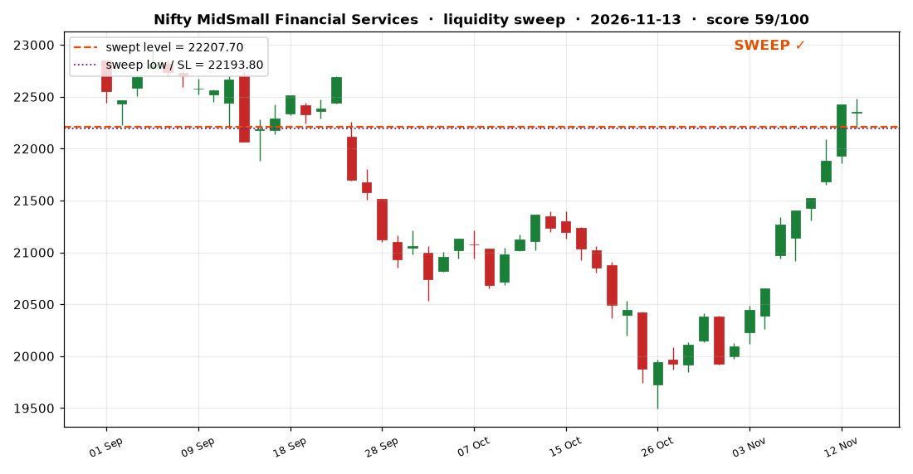
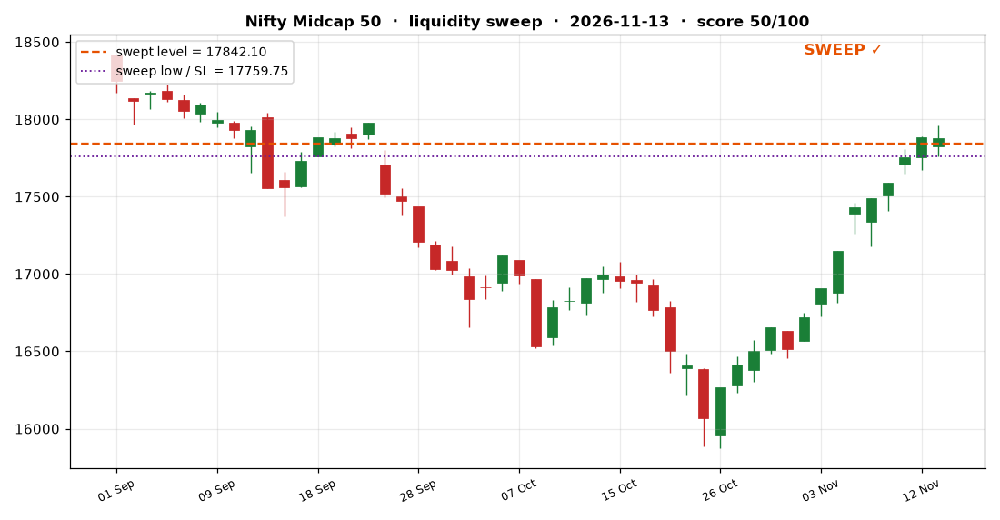
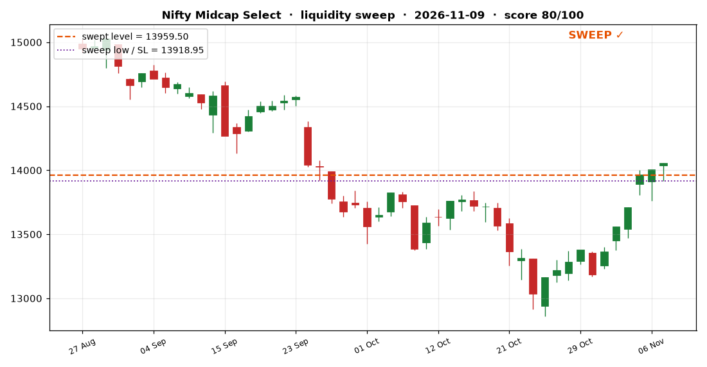
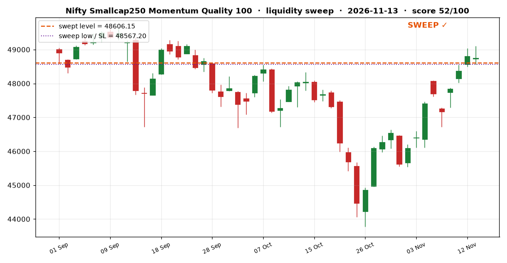
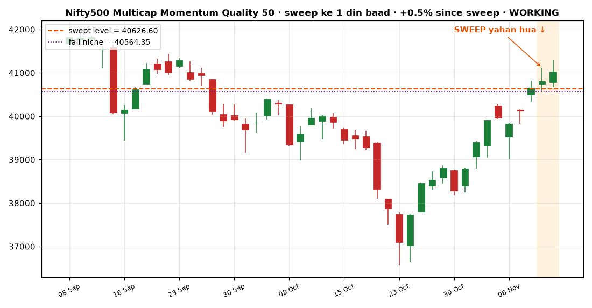
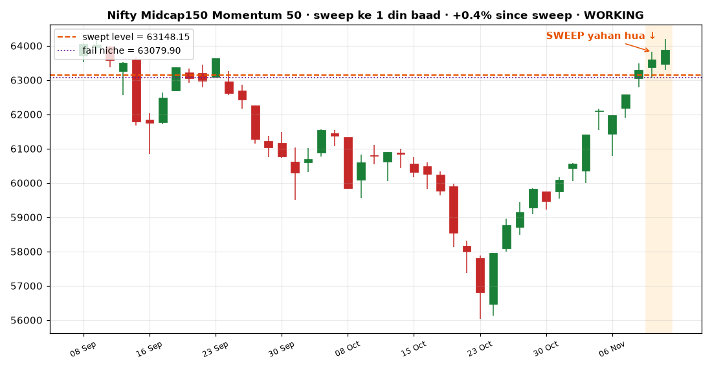
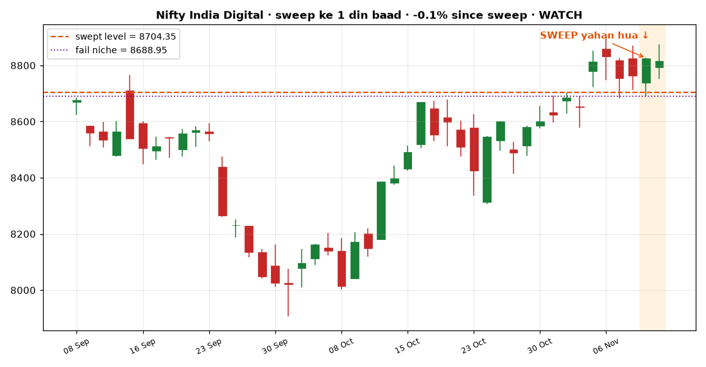
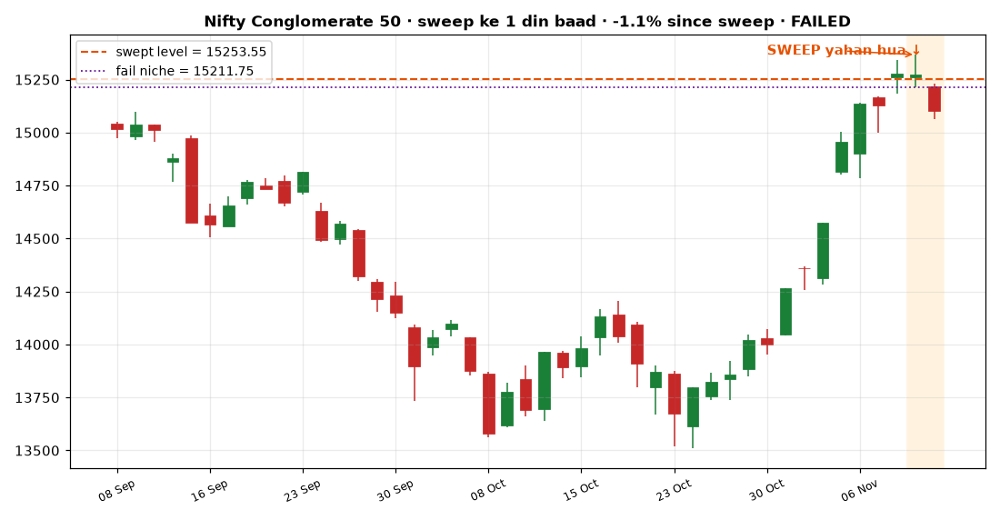

# 🙋 AAJ KA SIGNAL — Simple Bhasha Mein
### Date: 2026-11-13 (shaam ke NSE data se) | Nifty: 25144.3

---

## 🔴 EK LINE MEIN:
> **KHATRA zone — bade khiladi bech rahe hain ya market top ke paas lag raha hai. Naya paisa BILKUL mat lagao. Jo profit bana hai usko bachane ka waqt hai.**

---

## ✅ STEP-BY-STEP — AAJ KARNA KYA HAI:
1. Naya trade: BILKUL NAHI — chahe kitna bhi mann kare
2. Jo trades profit mein hain: thoda profit book kar lo (aadha bech do)
3. Jo loss mein hain: stop-loss aur tight karo (-5%)
4. Cash jama karo — jab STRONG signal aayega tab kaam aayega

---

## 💰 TOTAL KITNA PAISA MARKET MEIN RAKHNA HAI: **70%**
Matlab: agar tumhare paas kul **₹1,00,000** hai investing ke liye, to abhi sirf
**₹70,000** market mein ho aur **₹30,000 cash** mein.
Kyun? Trend upar hai LEKIN bade khiladi zor se BECH rahe hain — ye combo historically kharab hai — isliye thoda paisa nikal ke cash mein rakho.

---

## 📖 MARKET KA HAAL (simple):
| Cheez | Status | Matlab |
|---|---|---|
| Market ka trend | **UPAR ⬆️** | Nifty apni 200-din ki average price se upar hai = healthy |
| Bade khiladi (FII/operators) | **STRONG DOWN** | score -7.89 (+2.5 se upar = zor se kharid rahe; -2.5 se niche = zor se bech rahe) |
| 🟢 Bottom signal | **off** | abhi nahi |
| 🔴 Top warning | **🔴 ACTIVE** | Sab log overconfident = top ke paas ho sakte hain, profit bachao |

**Is signal ki accuracy:** Aise dino ke baad market 10 mein se sirf 5.5 baar upar gaya — yaani coin-flip se bhi bura. Paisa lagane ka koi matlab nahi.

---

## 🔭 AAGE KA NAZARIYA (aaj ke OI signal ke baad kya hota aaya hai — 15 saal ka hisaab)

| Kitne time baad | Kya expect karein | Imandar sach |
|---|---|---|
| **Kal (1 din)** | 🚫 Prediction NAHI | Humne 15 saal test kiya — agle din ka koi bhi signal **coin-flip** hai (53% up, har bucket mein same). Jo bhi "kal ye hoga" bole, usse door raho. |
| **1-4 din** | +0.0% avg, 52% baar upar | Bucket se 1-4 din ka koi bharosemand edge NAHI (aaj ka bucket +0.0%/52% vs baseline +0.2%/56% — farak na ke barabar). Sirf ⚡/🌀 flags fire hone par halka jhukav banta hai. |
| **15 din (3 hafte)** | 🔻 Kamzori ka signal | Aaj ka bucket: -0.0%/52% vs baseline +0.7%/60%. Yahan se signal jaagna shuru hota hai (curve-test: 15d par bearish edge pakki, bullish edge 20d+ se) — par asli kaam 20-60 din mein hi hota hai. 🔻 **Dhyan do: STRONG_DOWN ka 15-din edge ASLI hai** — 15 saal mein dono test-periods kamzor (IS -0.6pp / OOS -0.9pp, 52% vs 60% baseline). Agle 2-3 hafte naya paisa lagane ki jaldi mat karo. |
| **1 mahina (20 din)** | -0.0% avg, **51% baar upar** | baseline se KHARAB (baseline +1.0%/62%). Halka edge shuru hota hai. |
| **2 mahine (40-60 din)** | +0.7% avg, **53% baar upar** | baseline se KHARAB (baseline +3.0%/68%). **YAHI is system ka asli edge hai** — isliye swing hold 1-2 mahine ka hai. |

> 💡 **Matlab:** aaj entry lo to result ka asli test **1-2 mahine baad** hona hai. Beech ke din-hafte ka shor ignore karo — stop-loss (-10%) ke alawa koi reaction mat do.

## 📒 SYSTEM KA APNA REPORT CARD (pichhle 12 mahine ke 207 daily signals — khud ka hisaab)

**20-din accuracy: 65%  |  40-din accuracy: 54%** (✅ = jo promise kiya wahi hua: bullish/neutral bucket → market upar; STRONG_DOWN → market baseline se kamzor)

| Bucket | Signals | 20-din sahi | 40-din sahi | Avg 20d | Avg 40d |
|---|---|---|---|---|---|
| STRONG_UP | 44 | 50% | 25% | +0.2% | -1.3% |
| MILD_UP | 31 | 61% | 35% | +0.6% | -1.1% |
| NEUTRAL | 58 | 52% | 45% | -0.5% | -0.8% |
| MILD_DOWN | 21 | 48% | 52% | -0.5% | -1.5% |
| STRONG_DOWN | 53 | 100% | 100% | -4.3% | -4.9% |

**Aakhri 6 pakke (matured) signals:**

| Signal din | Bucket | 20-din result | 40-din result |
|---|---|---|---|
| 2026-09-15 | NEUTRAL | -2.1% ❌ | +8.8% ✅ |
| 2026-09-11 | MILD_UP | -2.9% ❌ | +8.1% ✅ |
| 2026-09-10 | MILD_UP | -4.7% ❌ | +7.6% ✅ |
| 2026-09-09 | MILD_UP | -3.9% ❌ | +6.9% ✅ |
| 2026-09-08 | NEUTRAL | -5.7% ❌ | +5.9% ✅ |
| 2026-09-07 | NEUTRAL | -4.9% ❌ | +3.2% ✅ |

**Abhi chal rahe (open) signals:**

| Signal din | Bucket | Beete din | Ab tak |
|---|---|---|---|
| 2026-11-12 | STRONG_DOWN | 1 din | -0.6% ⏳ |
| 2026-11-11 | STRONG_DOWN | 2 din | -0.4% ⏳ |
| 2026-11-09 | STRONG_DOWN | 3 din | +0.4% ⏳ |
| 2026-11-06 | STRONG_DOWN | 4 din | +0.5% ⏳ |
| 2026-11-05 | STRONG_DOWN | 5 din | +2.5% ⏳ |

> 🪞 **Ye section khud-ba-khud roz update hota hai — system apne purane signals se bhaag nahi sakta.** Accuracy girne lage to turant dikh jayega.

## 🏦 BANK NIFTY — WAHI SIGNAL, DUSRA INDEX (15-saal verified)

**Aaj:** Bank Nifty **61,034** (-0.79% din ka)

| Horizon | Aaj ke bucket (STRONG DOWN) ke baad BNF | Baseline |
|---|---|---|
| 15 din | -0.0% avg, 51% baar upar | +0.9% / 58% |
| 1 mahina | +0.0% avg, 51% baar upar | +1.2% / 59% |
| 2 mahine | **+0.4% avg, 53% baar upar** | +2.4% / 64% |

> 🔻 **BNF par bhi wahi kahani:** STRONG_DOWN mein Bank Nifty 2 mahine tak lagbhag flat/negative raha hai (baseline +2.4% chhodo) — BANKBEES entry se bhi door raho.
> 💡 Participant OI (FII/Pro) ka signal poore market ka hai — Bank Nifty par bhi 15 saal test kiya
> (correlation +0.157 @40d). STRONG_UP mein BNF ka 2-mahina record Nifty se bhi tez hai
> (out-of-sample +3.8%/79%). Trade karna ho to **BANKBEES** ETF.

## 🧭 SECTOR ROTATION — SABSE MAJBOOT SECTOR (15-saal tested)

**⏸️ STANDBY** — OI signal abhi bullish nahi (score -7.9 < +1.0). 15-saal test ne saaf dikhaya: sector tilt **sirf bullish signal ke saath** kaam karta hai (bina signal: out-of-sample NEGATIVE tha). Isliye abhi sirf ranking dekho, lagao mat.

| Rank | Sector | 6-mahina momentum |
|---|---|---|
| 1 | 🟢 **Realty** | +24.2% |
| 2 | 🟢 **Bank** | +17.0% |
| 3 | · **IT** | +15.9% |
| 4 | · **Auto** | +11.4% |
| 5 | · **Energy** | +8.5% |
| 6 | · **CapGoods** | +5.6% |
| 7 | · **Pharma** | +5.5% |
| 8 | · **Infra** | +4.4% |
| 9 | · **Telecom** | +1.2% |
| 10 | · **Finance** | +0.9% |
| 11 | · **Consumer** | +0.4% |
| 12 | · **Cement** | -2.0% |
| 13 | · **FMCG** | -8.5% |
| 14 | 🔴 **Metal** | -9.4% |
| 15 | 🔴 **Power** | -10.7% |

**Kya karna:** Intezaar. Jab upar wala signal MILD_UP/STRONG_UP ho, tab ye section ACTIVE ho jayega.

**Top-2 sectors ke stocks (RS order, sirf jankari ke liye):**
- **Realty:** DLF (+36%), PHOENIXLTD (+33%), PRESTIGE (+26%), OBEROIRLTY (+14%), GODREJPROP (+12%)
- **Bank:** PNB (+47%), ICICIBANK (+28%), FEDERALBNK (+28%), KOTAKBANK (+25%), IDFCFIRSTB (+20%), SBIN (+16%)

> 🔴 = sabse kamzor 2 sectors — yahan naya paisa mat lagao.
> 📏 Rule yaad rakho: KAB/KITNA upar ka MASTER SIGNAL batata hai — ye section sirf **KAHAN** (kaunsa sector) batata hai. Stop-loss -10% yahan bhi.

## 💎 GEM SCANNER — aaj koi setup nahi (2026-11-13)

**Pattern (15y decoded):** 52w-high se **40%+ gira** + **EMA50 wapas reclaim** (stabilize ho gaya) + **volume 1.5x surge** (koi bada jama kar raha). Test: aise setup ka **32.4%** chance hota hai +25% move ka (normal stock ka sirf 10.7%).

Aaj koi stock teeno sharten poori nahi karta — **ye normal hai** (ye setup mahine mein ~1 baar aata hai;
isi selectivity se edge hai). **Banne ke kareeb (volume ka intezaar):** VEDL.

**📒 Pichle gems ka hisaab:** 2026-10-08 TRENT: 🔄 OPEN +10% (24d) · 2026-10-09 TRENT: 🔄 OPEN +11% (23d) · 2026-10-14 TATAELXSI: 🔄 OPEN +13% (20d)

> 🔎 *Imandari note: backtest aaj ke zinda stocks par hai (survivorship) — isliye real expectancy thodi kam maan ke chalo; position sizing (5-10% max) hi asli suraksha hai. Midcaps par ye pattern TEST KIYA aur FAIL hua (+1.2% vs +6.7-11.5%) — gems sirf LARGE-CAP mein khoje jayenge, kyunki quality ka floor wahi hota hai.*

## 🏆 STOCK SWEEP — NIFTY 50 KE SABSE STRONG STOCKS (2026-11-12)

**Rule (15-saal tested):** A+ = price EMA50 ke upar **+** RS top-10% (126-din return, 50 stocks mein).
In stocks ne equal-weight basket ko average **+1.0pp (40 din) / +1.7pp (60 din)** se beat kiya
(out-of-sample bhi positive: +0.5/+1.1pp). Edge chhota par 15 saal consistent — horizon **1-3 mahine**.

| Stock | Grade | RS rank /100 | 1-mahina return | Price |
|---|---|---|---|---|
| **DIVISLAB** | A+ ⭐ | 100 | +21.8% | 11,485 |
| **ICICIBANK** | A+ ⭐ | 97 | +18.7% | 1,590 |
| **TECHM** | A+ ⭐ | 95 | +20.6% | 1,774 |
| **KOTAKBANK** | A+ ⭐ | 93 | +10.6% | 490 |
| **BAJFINANCE** | A+ ⭐ | 91 | +16.5% | 1,115 |
| HCLTECH | B (watch) | 89 | +12.9% | 1,381 |
| TRENT | B (watch) | 87 | +9.2% | 3,180 |
| TITAN | B (watch) | 85 | +11.9% | 4,922 |

> 💡 **Kaise use karein:** ye "kya kharidna" ka shortlist hai — lekin **kab/kitna** upar wala MASTER
> SIGNAL hi batayega. Entry signal weak ho to shortlist sirf watchlist hai. Stop-loss -10% yahan bhi pakka.

---

## 🧒 PAKKE NIYAM (har naye bande ke liye, HAMESHA):
1. **Stop-loss -10%:** jo bhi kharido, kharid-price se 10% girte hi bech do. Bina sawal. (15-saal test: -8% se -10% behtar nikla — bazaar ke chhote jhatke trade ko bekar mein nahi todte, aur bade nuksan se phir bhi bachata hai.)
2. **Kabhi ek saath pura paisa nahi** — hamesha 2-3 kisht mein.
3. **Udhaar/EMI/zaroorat ka paisa KABHI nahi** — sirf wo paisa jo 6 mahine na chahiye.
4. Ye system 10 mein se 7-8 baar sahi hai — **2-3 baar galat bhi hoga.** Isliye upar ke niyam hi tumhara asli bachav hain.
5. Kya kharidna hai confusion ho to: **NIFTYBEES** (Nifty 50 ETF) — isi index par ye pura system bana hai.

*Ye financial advice nahi hai — 15 saal ke data par bana educational system hai. | Generated: 2026-11-13T21:40:06+00:00 UTC*

---

## 🧲 INDEX SWEEP SCANNER — konsa index STRONG hai?

*Session: 2026-11-13 · scan: saare NSE indices (bond/G-sec chhodke)*

**Ye kya hai (1 line):** Jab koi index apne purane LOW ke niche wick maar ke wapas UPAR band ho (= stop-loss hunt complete), to wo index aur uske stocks aage strong rehne ke candidate hain.

### ✅ Aaj 4 index mein SWEEP COMPLETE hua:

| # | GRADE | Index | 20d RS rank | Swept Level | Depth% | Wick% | Close vs Level | RSI | Trend(>E50) | Score |
|---|-------|-------|-------------|-------------|--------|-------|----------------|-----|-------------|-------|
| 1 | 🟡 B | **Nifty MidSmall Financial Services** | 46/100 | 22207.70 | 0.06 | 53 | +0.64% | 68 | ✅ | 59 |
| 2 | 🟡 B | **Nifty Midcap 50** | 46/100 | 17842.10 | 0.46 | 34 | +0.20% | 69 | ✅ | 50 |
| 3 | 🟡 B | **Nifty Midcap Select** | 35/100 | 14232.90 | 0.06 | 31 | +0.80% | 67 | ✅ | 55 |
| 4 | 🟡 B | **Nifty Smallcap250 Momentum Quality 100** | 18/100 | 48606.15 | 0.08 | 31 | +0.30% | 61 | ✅ | 52 |

**GRADE ka matlab (1 saal, 131 indices, 1,486 sweeps par test kiya):**
- 🟢 **A+** = sweep + index pehle se STRONG (RS≥50) + trend upar → aage 10-20 din baaki market se behtar chalne ke best chances (+0.9% extra, 54-55% beat)
- 🟡 **B** = sweep + (strong RS *ya* uptrend, dono nahi) → theek-thaak, half conviction
- ⚪ **C** = weak index ka counter-trend sweep → KOI edge nahi mila, sirf jaankari

**Aaj ka #1: Nifty MidSmall Financial Services** (🟡 B) — level 22207.70 sweep karke +0.64% upar band hua.

**Kaise use karna (swing ke liye):**
- Ye WATCHLIST hai, buy-order nahi — A+ wale index (aur uske bade stocks) nazar mein rakho
- Agle din index **22207.70 ke UPAR TIKA RAHE** to setup valid
- Setup FAIL = close wapas sweep low (22193.80) ke niche → bhool jao
- Paisa lagana hamesha MASTER SIGNAL (upar wala) ke hisab se — ye scanner sirf batata hai KONSA index/sector strong hai

---

## 📅 WEEKLY SWEEP SCANNER — bada timeframe, zyada strong signal

*Last closed week ke hisab se · data till 2026-11-13 · ye signal pura hafta valid rehta hai*

**Ye kya hai (1 line):** Jo kaam daily sweep 1 din mein karta hai, wahi WEEKLY candle par ho to bade khiladi ka POORE HAFTE ka sauda dikhta hai — isliye ye signal zyada bharosemand hai (15-saal test: Nifty +8 hafte 69% win, Bank Nifty 76% win).

### Pichle closed week mein koi WEEKLY sweep setup NAHI bana.
Ye normal hai — weekly sweep rare hota hai. Jis hafte aayega, yahan chart ke saath dikhega.

---

## 📋 SWEEP REPORT CARD — pichle setups ab KAISE chal rahe hain?

*Yahan har sweep 1-2 hafte tak dikhta rahega taaki khud dekh sako: sweep ke baad sach mein uptrend aaya ya nahi.*

### 🧲 DAILY sweeps (pichle 10 din ke 69 setups):

| Index | Sweep kab | Kitne din hue | Tab close | Ab close | Badlav | Status |
|-------|-----------|---------------|-----------|----------|--------|--------|
| **Nifty500 Multicap Momentum Quality 50** | 2026-11-12 | 1 din | 40806.90 | 41026.85 | **+0.5%** | ✅ UPTREND chal raha |
| **Nifty Midcap150 Momentum 50** | 2026-11-12 | 1 din | 63605.55 | 63882.50 | **+0.4%** | ✅ UPTREND chal raha |
| **Nifty India Digital** | 2026-11-12 | 1 din | 8825.15 | 8815.20 | **-0.1%** | 🟡 WATCH (level ke upar tika hai) |
| **Nifty Conglomerate 50** | 2026-11-12 | 1 din | 15274.35 | 15101.95 | **-1.1%** | ❌ FAIL (sweep low tod diya) |
| **Nifty MidSmall Financial Services** | 2026-11-09 | 3 din | 21521.05 | 22350.90 | **+3.9%** | ✅ UPTREND chal raha |
| **Nifty Realty** | 2026-11-09 | 3 din | 897.70 | 921.25 | **+2.6%** | ✅ UPTREND chal raha |
| **Nifty Midcap Select** | 2026-11-09 | 3 din | 14055.45 | 14346.45 | **+2.1%** | ✅ UPTREND chal raha |
| **Nifty Chemicals** | 2026-11-09 | 3 din | 27974.45 | 28443.00 | **+1.7%** | ✅ UPTREND chal raha |
| **Nifty Midcap 50** | 2026-11-09 | 3 din | 17589.50 | 17877.45 | **+1.6%** | ✅ UPTREND chal raha |
| **Nifty 500** | 2026-11-09 | 3 din | 23567.00 | 23734.20 | **+0.7%** | ✅ UPTREND chal raha |
| **Nifty500 Multicap Infrastructure 50:30:20** | 2026-11-09 | 3 din | 14486.65 | 14564.75 | **+0.5%** | ✅ UPTREND chal raha |
| **Nifty India Defence** | 2026-11-09 | 3 din | 9041.15 | 9089.10 | **+0.5%** | ✅ UPTREND chal raha |
| *...aur 57 setups* | | | | | | *(unme ✅ 46 / ❌ 0)* |

### 📅 WEEKLY sweeps (pichle 3 closed weeks ke 1 setups):

| Index | Sweep week | Kitne hafte hue | Pools | Tab close | Ab close | Badlav | Status |
|-------|------------|-----------------|-------|-----------|----------|--------|--------|
| **Nifty Bank** | 2026-10-30 | 2 hafte | 1 | 54686.95 | 61034.10 | **+11.6%** | ✅ UPTREND chal raha |

**Scorecard (weekly):** ✅ 1 working | ❌ 0 failed | baki watch/kamzor — market ke saath milake dekho (agar pura market gira hai to sweep-fail market ki galti hai, system ki nahi).

⚠️ = Pools≥2 (ek saath kai lows toda) — test mein ye setups KAMZOR nikle (43% beat vs 59%), inse bachke raho.

**Status samajhna:** ✅ = sweep sahi nikla, uptrend chal raha | 🟡 = level ke upar hai, thoda aur time do | 🟠 = kamzor pada | ❌ = sweep low toot gaya = setup FAIL, bhool jao

